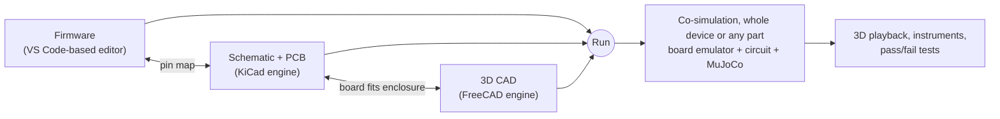

# Triage

**One app for code, circuits and 3D design, with a Run button that simulates the
whole device, or any part of it on its own.**

Engineering students write firmware in one tool, design PCBs in another and
model enclosures in a third, then copy pin numbers and re-export STEP files
between them. Nothing simulates the whole thing.

Triage is a **standalone desktop app built from VS Code's source**. It puts a
project's firmware, schematic and PCB (KiCad's engine), 3D enclosure and
mechanism (FreeCAD's engine, Blender-style UX) and renders (Blender) into one
linked project and **one window**. KiCad, FreeCAD and Blender run hidden behind
Triage's own tabs, so you never switch programs. **Run** executes the firmware on
an emulated microcontroller, drives the simulated circuit, and moves motors and
reads sensors in a 3D physics world, with automated pass/fail tests. You can also
simulate just the circuit, just the code or just the mechanism. Boards: **ESP32,
Arduino and Raspberry Pi**. Everything runs locally on a laptop, **Windows first**.

> **Status: building.** P0-1 (repository skeleton, CI on Windows and Linux) is
> done; see [docs/STATUS.md](docs/STATUS.md) for the current work package. The
> team is two: the owner and Claude.

## Documents

| | |
|---|---|
| [docs/STATUS.md](docs/STATUS.md) | Where we are, the next work package, confirmed decisions, defaults |
| [docs/PLAN.md](docs/PLAN.md) | Architecture: VS Code fork, hidden engines, project model, simulation kernel and scopes, decisions, risks |
| [docs/ROADMAP.md](docs/ROADMAP.md) | Phases P0–P8 as work packages with acceptance checks; milestones M1–M5 |
| [docs/GUIDELINES.md](docs/GUIDELINES.md) | How the owner and Claude build it: session routine, definition of done, forks, testing, Windows rules |
| [docs/adr/](docs/adr/0001-standalone-app-on-vscode-codebase.md) | Decisions: 0001 standalone app on VS Code's codebase, 0002 hidden engines, 0003 boards and Windows |
| [docs/research/](docs/research/README.md) | Full REA breakdowns of VS Code, KiCad, FreeCAD, Blender and the simulators |
| [CLAUDE.md](CLAUDE.md) | Instructions for every Claude session |

## Build from source

You need Node 22.12 or newer (pnpm comes through `corepack enable`), rustup (it
installs the pinned Rust 1.97.0 on first use), CMake 3.25+ with Ninja, and a C++20
compiler: GCC on Linux, MSVC on Windows (run the native build from a Visual Studio
developer shell). P0-6 replaces this list with setup scripts for both systems.

```sh
pnpm install
pnpm check                      # TypeScript: build, typecheck, lint, test (Turborepo)
cargo test --workspace          # Rust
cmake --workflow --preset dev   # Triage's own native C++ (configure, build, test)
pnpm format:check               # Prettier; `pnpm format:native:check` for C/C++ (clang-format 18)
```

CI runs the same checks on Windows and Linux ([.github/workflows/ci.yml](.github/workflows/ci.yml)).

| Folder | What |
|---|---|
| `app/` | the VS Code fork (P0-2) |
| `engines/` | native engine processes: KiCad, FreeCAD, Espressif QEMU forks, render scripts, hello engine |
| `crates/` | Rust: project model, simulation kernel, solvers |
| `sim/` | Node helpers for emulators, adapters, Pi bridge, network gateway |
| `parts/` | smart part library |
| `cli/` | the `triage` command line |
| `docs/`, `scripts/` | plan and research; dev, build and research scripts |

## The core idea



## How the plan was made

The real shipped builds of every tool were taken apart with **REA (Reverse
Engineer Anything)** in **unbounded mode**: no time limits and no fixed size
caps. That mode was added to the owner's fork (`NoboIshraque/rea`). The skill is
vendored in `.claude/skills/rea-full-breakdown/`, and
`scripts/research/teardown.sh` reproduces the research.

A sibling repository, `NoboIshraque/triad-extension`, keeps the earlier
alternative plan of shipping it as VS Code extensions (under the old working
name, Triad).
