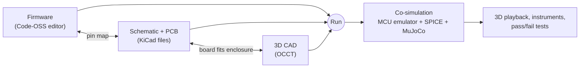

# Triad (working name)

**Code, circuits and 3D design in one app, with a Run button that simulates the
whole device.**

Engineering students write firmware in one tool, design PCBs in another and
model enclosures in a third, then copy pin numbers and re-export STEP files
between them. Nothing simulates the whole thing. Triad puts a project's
**firmware** (VS Code-style editor), **schematic and PCB** (KiCad-compatible)
and **3D enclosure and mechanism** (parametric CAD) in one linked project.
Pressing **Run** executes the firmware on an emulated microcontroller, drives
the simulated circuit, and moves motors and reads sensors in a 3D physics world,
with automated pass/fail tests. Everything runs locally on a laptop.

> **Status: planning.** This repository currently holds the research and the plan.

## Documents

| | |
|---|---|
| [docs/PLAN.md](docs/PLAN.md) | The master plan: architecture, unified project model, simulation kernel, tech stack, licensing, risks, decisions |
| [docs/ROADMAP.md](docs/ROADMAP.md) | Phased delivery with exit demos, timeline, and a solo-builder track |
| [docs/research/](docs/research/README.md) | Teardowns of the shipped VS Code, KiCad and Blender builds and of the simulation engines (ngspice, simavr, avr8js, rp2040js, Renode, MuJoCo), plus market and standards research |
| [CLAUDE.md](CLAUDE.md) | Working agreement for AI-assisted development in this repo |

## How the plan was made

The research used **REA (Reverse Engineer Anything)**, installed from the
sibling `rea` repository. Its skill is vendored in
`.claude/skills/reverse-engineer-anything/`. REA statically analyzed the
real Linux builds (VSCodium 1.143, KiCad 10.0.8, Blender 5.3, Renode 1.16.1,
MuJoCo 4.0.1, ngspice, simavr, avr8js, rp2040js) to learn how each is actually
put together. That covers process models, plugin boundaries, IPC protocols,
embedded engines and co-simulation hooks. Run `scripts/research/teardown.sh` to
reproduce it.

## The core idea in one picture

