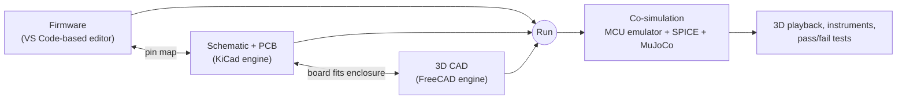

# Triad (working name)

**One app for code, circuits and 3D design, with a Run button that simulates the
whole device.**

Engineering students write firmware in one tool, design PCBs in another and
model enclosures in a third, then copy pin numbers and re-export STEP files
between them. Nothing simulates the whole thing.

Triad is a **standalone desktop app built from VS Code's source**. It puts a
project's firmware, schematic and PCB (KiCad's engine), 3D enclosure and
mechanism (FreeCAD's engine, Blender-style UX) and renders (Blender) into one
linked project and one window. **Run** executes the firmware on an emulated
microcontroller, drives the simulated circuit, and moves motors and reads
sensors in a 3D physics world, with automated pass/fail tests. Everything runs
locally on a laptop.

> **Status: planning complete.** The build starts at ROADMAP P0-1. The team is two:
> the owner and Claude.

## Documents

| | |
|---|---|
| [docs/STATUS.md](docs/STATUS.md) | Where we are, the next work package, open questions |
| [docs/PLAN.md](docs/PLAN.md) | Architecture: VS Code fork, engine processes, project model, simulation kernel, decisions, risks |
| [docs/ROADMAP.md](docs/ROADMAP.md) | Phases P0–P7 as work packages with acceptance checks; milestones M1–M4 |
| [docs/GUIDELINES.md](docs/GUIDELINES.md) | How the owner and Claude build it: session routine, definition of done, forks, testing |
| [docs/adr/](docs/adr/0001-standalone-app-on-vscode-codebase.md) | Decisions: 0001 standalone app on VS Code's codebase, 0002 absorb engines headless |
| [docs/research/](docs/research/README.md) | Full REA breakdowns of VS Code, KiCad, FreeCAD, Blender and the simulators |
| [CLAUDE.md](CLAUDE.md) | Instructions for every Claude session |

## The core idea

## How the plan was made

The real shipped builds of every tool were taken apart with **REA (Reverse
Engineer Anything)** in **unbounded mode**: no time limits and no fixed size
caps. That mode was added to the owner's fork (`NoboIshraque/rea`). The skill is
vendored in `.claude/skills/rea-full-breakdown/`, and
`scripts/research/teardown.sh` reproduces the research.

A sibling repository, `NoboIshraque/triad-extension`, keeps the alternative plan
of shipping Triad as VS Code extensions.
