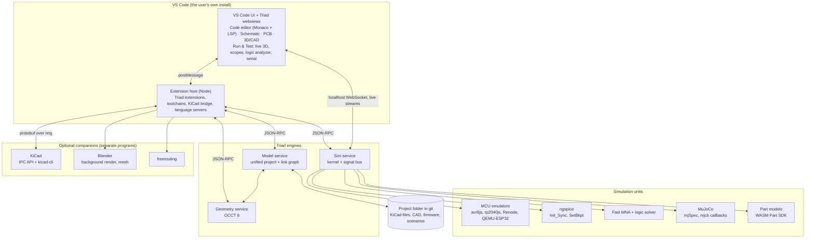
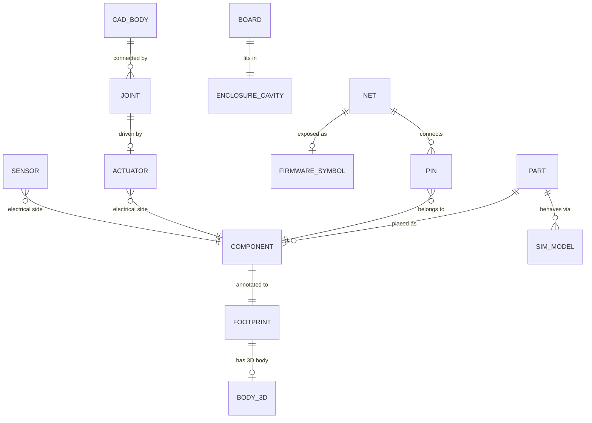
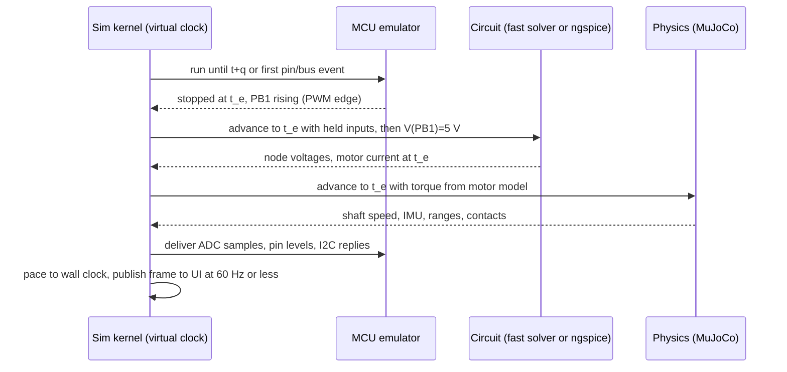

# Triad: master plan

> **Triad** is a working name for the three pillars (Code · Circuit · Form) plus
> the simulation that joins them. Rename freely.
> Status: **proposal v0.1**, 2026-11-23. It builds on the teardown in [research/](research/README.md).
> The phased delivery plan is in [ROADMAP.md](ROADMAP.md).

---

## 0. The plan on one page

**What we're building.** A suite of **VS Code extensions** that turns the editor
students already use into a full engineering workbench, running offline on a
laptop. A project's **firmware**, **schematic + PCB** and **3D
enclosure/mechanism** live in one project folder and one VS Code window, linked
to each other. A single **Run**
button simulates the whole device: the code runs on an emulated
microcontroller, drives the simulated circuit, which drives motors and reads
sensors in a 3D physics world. **Automated tests** then say pass or fail.

**Five big bets**

| # | Bet | Why (evidence) |
|---|---|---|
| 1 | **Run inside VS Code itself, as extensions** (VS Code Marketplace + Open VSX). No separate app, no fork | It's the most widely used code editor. Students install one extension into the VS Code they already have and keep their settings and extensions. We inherit Monaco, LSP/DAP, terminal, git, Test Explorer and the extension ecosystem. VS Code's own isolation pattern (narrow bridges, heavy work in separate processes, [vscode.md](research/vscode.md)) is the template for our engine processes |
| 2 | **KiCad-native files as the electronics source of truth.** KiCad runs as companion and headless engine; our own schematic then PCB editors come in phases | KiCad's formats are open text. kicad-cli covers DRC, ERC, every fab format, STEP/GLB and renders. The IPC API is protobuf over nng ([kicad.md](research/kicad.md)) |
| 3 | **Parametric B-rep CAD on OCCT 8** for enclosures, with Blender-style UX. **Blender is an optional render and mesh companion, not the core** | Engineering parts need exact dimensions and STEP. Blender is a mesh and render suite ([blender.md](research/blender.md)). OCCT 8.0.1 covers WebAssembly builds |
| 4 | **Our own co-simulation kernel.** Renode-style time quanta and FMI-3-style units wire MCU emulators, ngspice and MuJoCo together, with **wiring generated from the schematic and CAD assembly** | ngspice has `Init_Sync`/`SetBkpt` for lockstep. MuJoCo has `mjs_`/`mjcb_` for building models and injecting torques. Renode's `.repl` is effectively a netlist ([simulators.md](research/simulators.md)) |
| 5 | **Local-first, open formats, everything scriptable** (TS and Python APIs, CLI for CI, MCP server for AI agents) | Students need it free and offline. Instructors need autograding. Teams need git |

**Out of scope** (guardrails against an infinite project):
- Not a feature-complete replacement for KiCad, Blender or Fusion. We cover the
  80% that student and maker projects need, and keep **"Open in KiCad / Blender"**
  for the rest.
- Not a separate app and not a fork of VS Code (D2, confirmed). Triad lives
  inside VS Code.
- Not cloud-only, and no account is required.
- No high-speed or RF PCB design, no 20-layer HDI.
- No FEA or CFD in v1. Those are later sidecar integrations.
- Nothing copied from proprietary tools. Clean-room only.

**Decisions:** see §5. D2 is confirmed: run inside VS Code. Still open: D1
(licensing), D3 (first boards) and D8 (team and timeline).

---

## 1. Who it's for and what it must do

**Users:** engineering students (EE, ME, mechatronics, CS), robotics and
maker clubs, capstone teams, and instructors who set and grade lab work.

**Jobs to be done**
1. Design a device end to end without juggling 3–4 tools and manual exports.
2. **See it working before buying parts**: catch wiring, firmware, fit and power
   mistakes in simulation.
3. Hand off to manufacturing: Gerbers, BOM, pick-and-place, STEP, STL/3MF, firmware.
4. (Instructors) Ship templates and auto-graded test scenarios.

**Today's pain** (from [market-and-standards.md](research/market-and-standards.md)):
- Pin numbers get retyped by hand from the schematic into code.
- STEP is exported from KiCad into Fusion manually, again after every change.
- There is no system-level "does my robot actually work" check.
- Tinkercad is easy but toy-level and stalled.
- Proteus, Altium and Fusion are partial, paid or Windows-only.
- Wokwi's private projects and VS Code support are paid.

**Product principles**
1. **One project, one truth, many views.** Every object exists once and every
   view is a lens on it.
2. **Links, not exports.** Cross-domain relationships are live, so nobody
   copies a pin number or re-exports a STEP by hand.
3. **Progressive fidelity.** An instant, game-like interactive sim by default,
   with accurate engineering analysis one click away. The active tier is always visible.
4. **Open by default.** KiCad, STEP, glTF, MJCF, FMI and plain text in git.
   Leaving must be easy.
5. **Teach through feedback.** Errors explain physics: "LED current 48 mA
   exceeds 20 mA max; add ~150 Ω".
6. **Runs on a normal laptop.** 8–16 GB RAM, integrated GPU, offline.

---

## 2. What the teardown taught us

| Tool | How it's really built (observed in shipped builds) | What we adopt |
|---|---|---|
| **VS Code** | Electron: main process, sandboxed renderer, and utility processes (extension host, pty host, shared process, file watcher, agent host). The preload exposes **one 26-member `window.vscode` API**. The renderer gets **MessagePorts** straight to helper processes. Native addons: node-pty, parcel watcher, sqlite3, spdlog. RunAsNode fuse on | **Run inside VS Code as extensions.** Mirror its isolation: our editors are sandboxed webviews, our engines are separate processes behind narrow message contracts. Its enabled RunAsNode fuse is what lets extensions fork Node helpers (we use it for the JS emulators) |
| **KiCad** | `kicad` launcher hosting **kiface plugins** (`KIFACE_1`). The Python `pcbnew` module **is** the PCB editor binary. The **IPC API is protobuf over nng `ipc://`**, with 15 protos and requests serialized on the UI thread. **ngspice is dlopen'd**, OCCT handles STEP, libgit2 is built in. kicad-cli covers every fab and 3D format plus render and jobsets. Remote parts-provider protocol (OAuth2) | KiCad-native files, kicad-cli as headless engine, the IPC API for live sync. Become a **remote parts provider** that serves sim-ready parts into KiCad |
| **Blender** | One 197 MB binary with **statically embedded CPython** (exports the C API). Bundled engines: Embree, HIP-RT, SYCL, OSL, MaterialX, USD, OpenVDB, OpenSubdiv, OIDN, Vulkan, OpenXR. Bullet rigid bodies and Mantaflow fluids. An **RNA reflection layer** drives UI, Python and animation | The **reflection idea**: one schema drives UI, API, undo and files. Viewport, outliner, properties and modifier-stack UX. Blender as a separate render and mesh companion |
| **Simulators** | ngspice: `Init_Sync`, `SetBkpt`, event-node API. simavr: IRQ graph plus cycle timers plus GDB. avr8js/rp2040js: cycle clocks, pin listeners, sleep-skip. **Renode**: quantum time domains, a `{ActionId, Address, Data, PeripheralIndex}` co-sim protocol, `.repl` netlists. **MuJoCo**: `mjs_` model building, `mjcb_` control/sensor/actuator callbacks, batch rollouts | The sim kernel design (§4.7) |

---

## 3. A walkthrough: building a smart desk fan

This is the target experience that the roadmap builds toward.

1. **Install "Triad" from the VS Code Marketplace, then New Project → "Smart Fan
   (Arduino Uno)" template.** It creates one folder with `firmware/`,
   `electronics/` (a KiCad project), `mechanical/` and `simulation/`.
2. **Electronics.** Maya places an NTC thermistor + 10 kΩ divider on A0, a
   logic-level MOSFET + flyback diode driving a 12 V fan motor on D9, an SSD1306
   OLED on I²C and a button on D2. ERC runs live.
3. **Code.** `#include "board_pins.h"` is **generated from the schematic**
   (`FAN_PWM = 9`, `TEMP_SENSE = A0`...). Hovering `FAN_PWM` highlights the net
   in the schematic. Writing `analogWrite(10, …)` gives a squiggle: *"D10 is not
   connected to anything in electronics/smart-fan.kicad_sch"*.
4. **PCB.** She lays out the board: in KiCad in early phases, in Triad's own PCB
   editor later. The **3D view updates live inside the enclosure.**
5. **Mechanical.** "Enclosure from board": 2 mm walls, 5 mm clearance. It
   **automatically cuts openings** for the USB and DC jack, adds a fan grille
   pattern, and places **bosses aligned to the board's mounting holes**. A fit
   check flags *"OLED header intersects lid by 1.2 mm"* in red, so she raises
   the lid.
6. **Run (F5).** The firmware compiles and the emulated ATmega328P boots. The
   environment panel has a room-temperature slider. At 22 °C the fan is off. At
   35 °C, PWM reaches 80 % and the **fan blade spins in 3D**. The **OLED on the
   3D model shows "35.0C 80%"**. An oscilloscope shows motor current.
7. **Accuracy tier.** She switches the power stage to SPICE and deletes the
   flyback diode. The scope shows a **61 V spike** with *"exceeds MOSFET VDS max
   (55 V)"*. The simulation caught a real-world bug.
8. **Debug.** A breakpoint in `updateFan()` **freezes the whole world**:
   CPU, circuit and physics share one virtual clock. She steps through the code
   and watches the PWM pin change.
9. **Test.** `simulation/scenarios/overheat.yaml` ramps temperature from 20 to
   40 °C and expects duty ≥ 0.8 by 8 s and "HOT" on the OLED. It runs in the
   Test Explorer and in CI (`triad test`).
10. **Release.** `triad export release` writes Gerbers, drill files, BOM and CPL,
    enclosure STEP, 3MF, `firmware.hex` and the test report into one zip.

---

## 4. Architecture

### 4.1 System overview



### 4.2 Processes

We follow VS Code's model: crash isolation, a sandboxed UI, and heavy work off
the UI thread.

| Process | Tech | Responsibilities | If it crashes |
|---|---|---|---|
| VS Code main + renderer | Microsoft VS Code (not ours) | windows, Monaco, terminal, git, Test Explorer, debug UI | – |
| **Triad webviews** | TS + React + WebGL2/WebGPU, inside VS Code custom editors and panels | schematic, PCB, 3D/CAD and Run & Test views. Heavy geometry in Web Workers and WASM | the editor reloads its webview; state restored |
| Extension host | Node (VS Code's) | **Triad extensions**: project explorer, commands, custom editor providers, toolchains (PlatformIO, arduino-cli, CMake), KiCad and Blender bridges. Launches and supervises the engine processes | VS Code restarts the extension host; engines reconnect |
| **Model service** | Rust executable | loads and saves the project, KiCad S-expression I/O, link graph, change events, undo | UI shows "reconnecting", reloads from disk |
| **Geometry service** | C++ OCCT 8 executable | heavy B-rep ops, STEP import/export, tessellation, mass properties, interference | CAD ops retry |
| **Sim service** | Rust kernel + engines, plus a forked Node helper for the JS MCU emulators | scheduler, signal bus, ngspice, MuJoCo, avr8js/rp2040js, child Renode/QEMU | simulation stops with an error; editors unaffected |
| Companions | KiCad, Blender, Renode (.NET), QEMU, freerouting | as installed, via public interfaces | feature degrades gracefully |

**IPC.** Webviews talk to the extension through `postMessage`, which transfers
`ArrayBuffer`s efficiently for extensions targeting VS Code 1.57+. The
extension talks to the engines with JSON-RPC 2.0 (the `vscode-jsonrpc` stack that
language servers use), with schema-validated messages. **High-rate streams**
(waveforms, transforms, framebuffers) skip the extension host: the sim service
serves a **localhost WebSocket** that the webview connects to directly. It is
allowed by the webview's CSP, and VS Code's webview port mapping covers remote
setups. KiCad is reached through its protobuf/nng IPC API, and Renode through
its monitor socket and GDB.

### 4.3 The unified project model (the heart of the app)

**Folder layout.** Everything is plain files, so git just works:

```
smart-fan/
  triad.toml                 # manifest: name, targets, boards, sim defaults, links file
  firmware/                  # PlatformIO / Arduino / CMake / Zephyr / MicroPython project
    src/main.cpp
    generated/board_pins.h   # generated from schematic (do not edit)
  electronics/               # a normal KiCad 10 project
    smart-fan.kicad_pro  smart-fan.kicad_sch  smart-fan.kicad_pcb
  mechanical/
    enclosure.triad-cad.json # feature tree (sketches, extrude, shell, fillet, pattern...)
    assembly.triad-asm.json  # bodies, joints, motors, materials
    exports/                 # STEP/3MF/STL (generated)
  simulation/
    environment.toml         # temperature, light, gravity, obstacles...
    scenarios/*.yaml         # stimulus + expectations (tests)
  parts/                     # project-local smart parts
  .triad/links.json          # cross-domain link graph (stable IDs)
```

**One schema, many uses (the "RNA" lesson from Blender).** Every entity type
(component, net, board, body, joint, actuator, sensor, scenario, parameter) is
defined once in a **schema** (JSON Schema plus annotations). From it we
generate TS and Python API types, the property panels, file validation, undo
records and docs.

**Link graph:**



- **Stable IDs.** KiCad's UUIDs for symbols, footprints and nets are reused, and
  our own entities get UUIDv7s. `.triad/links.json` stores the cross-domain
  edges with both IDs, so links survive renames and re-annotation.
- **Change propagation.** Edits are **commands** (`MoveFootprint`,
  `RenameNet`...) applied to the model service. Dependents are recomputed
  lazily through a small **dependency graph**, Blender-depsgraph style: renaming
  net `FAN_PWM` updates `board_pins.h`, the Renode `.repl`, scenario references
  and 3D labels.
- **Undo** is a transaction log of commands across domains. One undo can revert
  "moved connector + enclosure cutout followed".
- **Parameters.** A project-wide table (`board_w = 50 mm`, `wall = 2 mm`)
  usable in PCB outline expressions, CAD features, firmware constants (generated)
  and simulation.
- **Conflicts with external edits** (the user edits the PCB in KiCad): a file
  watcher detects the change, the model re-parses, the link graph is reconciled
  by UUID, and broken links are listed in a "Links" problems view.

### 4.4 Workspaces

| Workspace | Phase A (bridge) | Phase B+ (own) |
|---|---|---|
| **Code** | VS Code + C/C++ support (Microsoft's C/C++ extension or clangd). PlatformIO Core / arduino-cli / CMake / ESP-IDF / Zephyr tasks. **pin-map codegen + "unconnected pin" diagnostics**. MicroPython for RP2040 | debug-in-sim (DAP → GDB → emulator stub), register and peripheral views |
| **Electronics** | Our schematic and PCB **viewers** (WebGL). **Edit in KiCad** with IPC cross-probing. kicad-cli for ERC, DRC and fab | own **schematic editor** (Phase 3), then **PCB editor** (Phase 5), still saving `.kicad_*` |
| **Mechanical** | 3D board from `kicad-cli pcb export glb`. Template enclosures with OCCT (box/shell/holes/cutouts) | full parametric CAD: constrained sketches, features, assemblies with joints → physics (Phase 4) |
| **Simulation & Test** | T0 interactive sim on AVR (avr8js). Serial monitor, LED/motor in 3D, scenario tests | T1 SPICE co-sim, RP2040, Renode, ESP32, FMU import, sweeps, coverage |

### 4.5 Cross-domain features (why this app exists)

1. **Pin map sync (schematic ↔ firmware).** A generated header, devicetree
   overlay or Python module, plus an LSP-style checker for unknown,
   unconnected or misused pins (for example ADC on a non-ADC pin).
2. **Cross-probe everywhere.** Select a symbol, net, pad, 3D body or line of
   code and it highlights in every other view.
3. **Board ↔ enclosure.** Outline, mounting holes and connector positions
   drive enclosure features. **Interference and clearance checks** use OCCT
   distance and boolean ops on component bodies against enclosure solids.
4. **Live 3D.** The PCB sits inside the enclosure and updates on every board
   edit (incremental tessellation).
5. **Mechatronics in one place.** Motors, servos and sensors are single smart
   parts with electrical, mechanical and simulation sides (§4.6).
6. **Run.** Build firmware → assemble the co-simulation from schematic,
   assembly and environment → play in 3D with instruments.
7. **Debug the world.** Breakpoints pause CPU, circuit and physics together.
8. **Test.** Scenario files hold stimulus plus expectations. They run headless
   in CI, and instructors can grade with them.
9. **One release bundle.** Fab files, mechanical exports, firmware, BOM with
   cost, and a test report.

### 4.6 Smart parts

A **smart part** is the unit that ties every domain together:

```
parts/hc-sr04/
  part.toml          # metadata, pins, parameters, datasheet link
  symbol: KiCad lib ref or .kicad_sym   footprint: .kicad_mod   model: .step/.glb
  sim/behavior.wasm  # Part SDK model (pins, timers, I2C/SPI/UART devices, framebuffers)
  sim/spice.lib      # optional SPICE subcircuit for the accuracy tier
  mech.toml          # mass, mounting frame, sensor frame (ray origin/direction), joint hooks
  firmware/          # optional driver hints (Arduino library name, Zephyr binding)
```

- **Part SDK.** Our own C/Rust/AssemblyScript → **WebAssembly** API for
  behavioral models. It covers pin read/write/watch, timers, I²C/SPI/UART device
  callbacks, analog outputs, a framebuffer for displays, and access to the
  physics frame for sensors. It follows the spirit of Wokwi's Chips API (pins,
  watches, timers), but it is our own design. WASM keeps community models
  sandboxed and portable to the web.
- **Library sources:** KiCad's official symbol, footprint and 3D libraries,
  plus our sim-model library. Starter set of about 100 parts: LEDs, R/C/L,
  buttons, pots, LDR, NTC, DHT22, HC-SR04, MPU-6050, SSD1306, servo, DC motor,
  L298N/DRV8833, MOSFETs, relay, buzzer and WS2812.
- **KiCad remote provider.** Because KiCad 10 speaks a parts-provider protocol,
  we can serve our smart parts straight into KiCad as well.

### 4.7 Simulation architecture

#### Fidelity tiers

| Tier | Electrical | Firmware | Mechanics | Speed target |
|---|---|---|---|---|
| **T0 Interactive** (default) | event-driven logic plus a **fast MNA solver** for small analog islands (dividers, RC, LEDs) | cycle-accurate MCU emulators | MuJoCo, 1 kHz fixed step | ≥ 1× real time |
| **T1 Accurate** | **ngspice transient** for selected analog nets, co-simulated with the MCU | same | same | 0.05–1× real time |
| **T2 Analysis** | ngspice OP/DC/AC/noise/sweeps/Monte Carlo, offline | – | (later) FEA/thermal via sidecars | batch |

The UI always shows the active tier per subsystem, for example
"Power stage: SPICE · Logic: fast".

#### Simulation units

Every engine is wrapped as a **unit** with an FMI-3-like contract. Inputs and
outputs are typed ports. The core call is
`doStep(t, Δt) → reached | earlyReturn(t_e, events)`, with event handling and
state save/restore:

| Unit | Engine | Ports |
|---|---|---|
| MCU (AVR) | avr8js (in-process worker) | GPIO, ADC, PWM, UART/I²C/SPI transactions |
| MCU (RP2040) | rp2040js | GPIO, PIO, ADC, PWM, I²C/SPI/UART, USB CDC |
| MCU (STM32, nRF52...) | Renode (child process; `.repl` generated) | GPIO and bus messages; quantum sync |
| MCU (ESP32) | QEMU, Espressif fork (child process) | GPIO, UART, Wi-Fi stubs |
| Circuit T0 | our Rust MNA + logic solver | net voltages, currents, logic levels |
| Circuit T1 | ngspice shared library | external sources (`Init_Sync`), breakpoints (`SetBkpt`), event nodes |
| Mechanics | MuJoCo | joint torque in; angles, rates, IMU, ranges, contacts out |
| Parts | Part SDK WASM | per part |
| Environment | built-in | temperature, light, distance targets, gravity, wind |
| External | **FMI 3.0 FMU** import | as declared |

#### Time and scheduling

- **One global virtual clock**: `int64` picoseconds, about 106 days of range,
  enough for 240 MHz cycles.
- **Conservative, quantum-based synchronization** (Renode's model). The kernel
  advances the **event producers (MCUs) first**, up to the quantum end or their
  first output event. Each unit stops early at a pin edge or bus transaction,
  which is the FMI 3.0 "early return". Continuous units (circuit, physics)
  then catch up to that time with zero-order-hold inputs, the event is applied,
  and the loop repeats.
- **Sync on demand** for analog reads. When firmware reads the ADC at time *t*,
  the MCU pauses, the circuit is advanced exactly to *t* (`ngSpice_SetBkpt` in
  T1), and the true voltage is returned. Rare, exact, cheap.
- **Adaptive quantum**: 1 ms when nothing is happening, down to 1 µs around
  fast interactions. MCUs that are asleep skip ahead, as rp2040js does.
- **Real-time pacing**: virtual time is throttled to the wall clock, like
  Renode's default. The UI shows the "×0.73 real time" ratio. Users can
  run as fast as possible, slow-mo or single-step.



#### Netlist partitioning (the key to real-time speed)

The schematic netlist is split automatically:
- **Digital nets** (MCU ↔ logic parts) are event-driven: edges with timestamps.
- **Bus nets** (I²C, SPI, UART) are simulated **at transaction level** between
  MCU peripheral models and part models, like Renode's
  `ReadFromBus`/`WriteToBus` messages. There is no SPICE on a 1 MHz clock line.
- **Analog islands** (sensor dividers, RC filters, power stages) go to the fast
  solver in T0 or to ngspice in T1, per island.
- Adapters convert between domains: logic thresholds (V_IH/V_IL), PWM as
  either the averaged voltage (T0) or real switching edges (T1), and ADC
  sampling with quantization.

#### Electro-mechanical coupling

- **DC motor:** `V = R·i + L·di/dt + Ke·ω` and `τ = Kt·i − b·ω` (plus
  gearbox). The electrical half lives in the circuit unit. Torque enters
  MuJoCo through **`mjcb_control`/actuator callbacks**, and ω comes back each step.
- **Hobby servo:** pulse width → target angle → internal P-controller with a
  speed limit → MuJoCo position actuator.
- **Stepper:** step/dir pulses → discrete angle increments with torque limit and stall detection.
- **Sensors:** IMU from MuJoCo accelerometer and gyro sensors plus noise,
  exposed through an MPU-6050 register model. Rangefinder (HC-SR04) uses
  `mj_ray` distance turned into echo pulse width. Encoders turn joint angle into
  quadrature edges. Limit switches use contacts.
- **The physics model is built with `mjs_*` from the CAD assembly.** Rigid
  groups are welded into single bodies (the KSP lesson). Joints come from mates,
  and masses and inertias from OCCT and material density.

#### Instruments and visualization

Live 3D shows LED glow (∝ current), displays as textures (OLED framebuffer on
the 3D part), spinning shafts, servo horns and NeoPixel colors. Also: an
oscilloscope (any net), a **logic analyzer** with protocol decode
(I²C/SPI/UART), a serial terminal, plots of any physics quantity,
the energy and current budget, and a "what's happening" event log.

#### Determinism, recording, replay

All units are deterministic for a given input sequence. Noise uses seeded RNGs.
UI interactions (button presses, slider moves) are recorded **with virtual
timestamps**, so any run can be **replayed exactly**. That is essential for
debugging and for fair grading.

#### Tests

```yaml
# simulation/scenarios/overheat.yaml
name: fan reacts to overheating
duration: 12s
environment: { temperature_C: { ramp: [20, 40], over: 10s } }
expect:
  - at: 8s
    that: pwm_duty(net: FAN_PWM) >= 0.8
  - within: [9s, 12s]
    that: oled(U3).text contains "HOT"
  - always: current(net: +12V) < 1.5A
```

Tests run in VS Code's **Test Explorer** and through `triad test` (CLI,
headless, JUnit output) in CI. Coverage reports show which firmware lines and
which scenario expectations were exercised.

### 4.8 Rendering and UI technology

| Surface | Choice | Notes |
|---|---|---|
| Schematic and PCB canvas | **Custom 2D GPU renderer** in a VS Code custom editor (webview): WebGL2 now, a WebGPU backend when available | KiCad's GAL lesson: cached GPU geometry per layer and item, instancing, LOD, culling, MSDF text, KiCad's stroke font for fidelity. Clipper2 (WASM) for polygon ops |
| 3D | **three.js** (WebGPURenderer with WebGL2 fallback) | WebGPU on Linux is still rolling out per GPU (Chrome 144+), **so the fallback is required** |
| Panels and inspectors | React + TS inside webviews; native VS Code tree views, status bar items, quick picks and walkthroughs where they fit | narrow messaging contracts |
| Plots | uPlot (waveforms), custom WebGL logic-analyzer view | millions of samples |
| Heavy compute in UI | Web Workers + WASM (OCCT for interactive CAD, Manifold for mesh booleans, Clipper2) | keep the UI thread under 8 ms per frame |

### 4.9 Interop and file formats

| Need | Format | Via |
|---|---|---|
| Electronics source | KiCad native S-expression and JSON | our Rust parser/serializer (lossless round-trip; tested on the `kicad-demos` corpus) |
| Fabrication | Gerber X2, Excellon, IPC-2581, ODB++, BOM, CPL | `kicad-cli` (`jobset run`) |
| 3D board | GLB/STEP | `kicad-cli pcb export glb|step` → later our own incremental generator |
| Mechanical | STEP AP214/AP242, 3MF, STL, glTF | OCCT |
| ECAD↔MCAD with other CAD tools | STEP now, **IDX** later | follows KiCad's IDX work (aiming for v11) |
| Physics | MJCF/mjSpec, URDF export | MuJoCo |
| Co-sim models | FMI 3.0 FMU import, SSP | our kernel |
| Waveforms | VCD/FST, sigrok sessions | instruments |
| Firmware | ELF/HEX/UF2, GDB RSP, DAP | toolchains and emulators |
| Renders | Blender `.blend`/glTF/USD | Blender companion |

### 4.10 Extensibility and automation

- **Triad is itself a set of VS Code extensions.** Other extensions can call a
  **`triad` TS API** (returned from our `activate()`), and users keep every other
  extension they already use.
- **Python API** (`import triad`): project, schematic, PCB, CAD, sim and test,
  in the spirit of `bpy` and `pcbnew`. It runs in a separate Python process over
  JSON-RPC, so a bad script can't crash the UI.
- **CLI** `triad`: `build`, `sim run`, `test`, `erc`/`drc` (delegating to
  kicad-cli), `export release`. CI-friendly with JUnit output.
- **MCP server**: `list_nets`, `get_pin_map`, `run_drc`, `run_scenario`,
  `get_waveform`, `screenshot_3d`... AI agents, including Claude during
  development, can operate the app and verify their own changes. Added early
  because it is cheap and multiplies our testing.
- **KiCad integration:** an IPC API plugin (`plugin.json` with Python/exec
  runtime) adds a "Send to Triad / sync" action inside KiCad. The parts-provider
  endpoint feeds smart parts into KiCad.

### 4.11 Tech stack summary

| Layer | Choice | License |
|---|---|---|
| Host | **VS Code** (the user's install). Published on the VS Code Marketplace, and on Open VSX for VSCodium, Cursor and other forks | VS Code: Microsoft's license. Our extensions: ours |
| Our UI code | TypeScript, React (panels), custom WebGL2/WebGPU renderer, three.js | ours, MIT |
| Core libraries | Rust (napi-rs for Node, wasm-bindgen for web): KiCad file model, link graph, sim kernel, MNA solver | ours |
| CAD kernel | OCCT 8 (native + WASM), Manifold (mesh booleans), sketch solver: PlaneGCS (LGPL) or SolveSpace (GPL-3), decided by D1 | LGPL-2.1+exc / Apache-2.0 |
| Circuit sim | ngspice (shared library; WASM for web, as eecircuit-engine shows) | BSD-3 / LGPL-2 / GPL-2+ parts |
| MCU emulation | avr8js, rp2040js (JS); Renode (.NET); QEMU-ESP32 | MIT / MIT / GPL-2 |
| Physics | MuJoCo 4 | Apache-2.0 |
| Toolchains | PlatformIO Core, arduino-cli, CMake + Arm GNU, ESP-IDF, Zephyr, MicroPython | Apache / GPL-3 (separate) / ... |
| Language servers | clangd, Pyright | Apache-2.0 + LLVM exc. / MIT |
| IPC | JSON-RPC 2.0 (`vscode-jsonrpc`), webview `postMessage` with transferred ArrayBuffers, localhost WebSocket for live streams, protobuf (KiCad) | – |
| Storage | plain files; SQLite caches (as VS Code does) | – |
| Tests | Vitest, **@vscode/test-electron** (integration tests in a real VS Code, stable and Insiders), Playwright (webviews), cargo test, golden files from `kicad-demos`, sim regression scenarios | – |

### 4.12 Licensing and process boundaries (Decision D1)

Every engine we picked is compatible with **GPL-3.0**. The real choice is
whether **our own code** should be permissive or GPL.

| Option | What it allows | What it costs |
|---|---|---|
| **A. Apache-2.0 for our code + strict process boundaries** *(recommended to start)* | Any future model: open-source community edition, commercial or cloud editions, dual licensing. GPL tools (KiCad, Blender, simavr, QEMU, freerouting) stay separate programs reached through public interfaces. Binaries that link GPL code (the sim service with ngspice/simavr) are distributed as separate GPL-3 programs | We can't paste KiCad or Blender C++ into our own process. Our PCB router and DRC must be written by us or run in a separate GPL engine program |
| **B. GPL-3.0-or-later for everything** | Merge KiCad and Blender code directly (for example KiCad's push-and-shove router and DRC engine compiled into our PCB editor). Simplest licensing story. Natural ally of the KiCad and Blender communities | No proprietary distribution, ever. A hosted SaaS fork is still possible unless we pick AGPL |

**Why start with A:** Apache-2.0 code can be relicensed into a GPL-3 project
later. GPL code can't go the other way without every contributor's consent. We
keep the process boundaries either way, for crash isolation and because KiCad
and Blender update independently. **Revisit before Phase 5**, when reusing
KiCad's router becomes tempting. *This is not legal advice; get a review before
the first public release.*

Hard rules under A:
1. Never load GPL code into the extension host, our webviews or the model service.
2. Talk to GPL programs only through documented protocols (KiCad IPC API, CLIs, sockets, files).
3. QEMU (GPL-2.0-only) always runs as a separate process.
4. Keep a `THIRD_PARTY_NOTICES` file and an SBOM, generated in CI.
5. Triad runs inside the user's own VS Code under Microsoft's license. We never
   redistribute VS Code, so its license doesn't constrain ours.

### 4.13 Security

- **Workspace Trust:** our extensions declare limited support for untrusted
  workspaces (`capabilities.untrustedWorkspaces`). Building or running a cloned
  project's toolchain, Python scripts and part models waits until the user
  trusts the folder.
- Firmware only ever runs **inside emulators**. Part models are **WASM**
  (sandboxed, no syscalls).
- Webviews get a strict CSP, `localResourceRoots` limited to the extension and
  the project, and no Node. Messages are schema-validated on both sides, the same
  narrow-bridge discipline as VS Code's 26-member preload.
- We don't ship Electron, so its fuses are VS Code's responsibility. We rely
  only on RunAsNode, to fork the Node helper for the JS emulators. If a future VS
  Code disables it, we fall back to a system or bundled Node runtime.
- Downloaded companions (KiCad, Renode...) are verified by checksum and signature.

### 4.14 Performance budgets

| Scenario | Budget (mid-range laptop, integrated GPU) |
|---|---|
| Extension activation (lazy, via activation events) | ≤ 500 ms; first project open ≤ 3 s |
| Schematic pan/zoom | 60 fps at 5k items |
| PCB pan/zoom | 60 fps at 50k items (tracks, pads, vias, zones) |
| 3D board + enclosure | 60 fps at 2M triangles |
| T0 sim: Uno-class MCU + ≤ 30 parts + ≤ 20 bodies | ≥ 1× real time on one core |
| T1 sim: ≤ 200 SPICE nodes co-simulated | ≥ 0.1× real time |
| Typical project memory | ≤ 3 GB total |

Each budget becomes an automated benchmark in CI (see ROADMAP Phase 0).

### 4.15 Platforms and packaging

- **Install** from the **VS Code Marketplace**, or from **Open VSX** for
  VSCodium, Cursor and other forks. Windows, macOS and Linux, x64 and arm64.
  VS Code handles updates.
- **Native engines** ship as **platform-specific VSIX packages**
  (`vsce package --target linux-x64`, `darwin-arm64`, `win32-x64`...) built by
  a CI matrix. Large optional engines download on first use and are
  checksum-verified.
- **Companions** are detected if installed, or offered for download on first
  use. KiCad is needed only for kicad-cli functions until our own engines replace them.
- **Remote setups** work (Remote-SSH, WSL, Codespaces). Engines run next to the
  files, and webviews reach them through port mapping. Handy for school lab machines.
- A **web edition** (later) runs as a web extension on vscode.dev. It reuses the
  WASM builds of everything: OCCT, ngspice (eecircuit-engine proves it), the JS
  MCU emulators and three.js.

---

## 5. Key decisions

| # | Decision | Recommendation | Status |
|---|---|---|---|
| D1 | License of our code | **Apache-2.0 + process boundaries**; revisit before Phase 5 (§4.12) | **needs you** |
| D2 | Host | **Extensions for the real VS Code** (Marketplace + Open VSX). No fork, no separate app. See [ADR 0001](adr/0001-run-inside-vscode.md) | **confirmed 2026-11-23** |
| D3 | First boards | **Arduino Uno (AVR) + Raspberry Pi Pico (RP2040)**: fully open emulators. Then STM32/nRF52 (Renode), then ESP32 (QEMU). *If your courses live on ESP32, we pull it earlier* | **needs you** |
| D4 | Electronics editing | KiCad companion first; own schematic editor in Phase 3, own PCB editor in Phase 5; KiCad files throughout | proposed |
| D5 | CAD kernel | **OCCT 8** (native + WASM) + Manifold; Blender as companion | proposed |
| D6 | Physics | **MuJoCo 4** (reduced coordinates, mjSpec, callbacks) | proposed |
| D7 | Core language | TypeScript (UI and extensions) + Rust (model, kernel, solvers) | proposed |
| D8 | Team and timeline | Roadmap assumes a team of 4–6. A solo builder with AI assistance should cut scope to Phases 0–2 for a first release | **needs you** |
| D9 | Name | "Triad" placeholder | needs you |

---

## 6. Risks and mitigations

| Risk | Likelihood / impact | Mitigation |
|---|---|---|
| **Scope explosion**: three huge apps plus simulation | High / fatal | Vertical slices with hard exit criteria (ROADMAP). KiCad and Blender carry the long tail through "Open in…". Say no to features outside student needs |
| PCB editor is far harder than it looks (router, zones, DRC) | High / high | Keep KiCad as companion until Phase 5. kicad-cli remains the DRC sign-off. Reconsider D1 to reuse KiCad's router |
| Co-sim too slow or unstable | Medium / high | Netlist partitioning, transaction-level buses, adaptive quanta, T0/T1 tiers, MuJoCo's stable solver. Benchmarks in CI |
| VS Code's extension API can't do something we need (custom layouts, native canvases outside webviews) | Medium / medium | Custom editors, webview panels and views, tree views and walkthroughs cover everything in this plan. Use only stable APIs. A branded Code-OSS build stays the last resort (Positron's route), and our extensions would carry over unchanged |
| Webview performance on big boards and assemblies | Medium / medium | GPU canvases, workers and WASM, transferred ArrayBuffers, direct WebSocket streams. Profile against the §4.14 budgets from Phase 1 |
| VS Code updates break us | Low / medium | CI runs integration tests against VS Code stable and Insiders. Declare the minimum version in `engines.vscode` |
| KiCad API churn (IPC API young, headless in v11) | Medium / medium | Isolate it behind our `kicad-bridge` interface. Prefer file I/O + kicad-cli. Track KiCad 11 |
| Simulation inaccuracy misleads students | Medium / high | Tier labels, model provenance per part, "validated against" notes, warnings when assumptions are violated |
| Licensing mistake | Low / high | §4.12 rules, SBOM and license scan in CI, review before the first release |
| WebGPU and graphics fragmentation | Medium / low | WebGL2 baseline everywhere, WebGPU as an opt-in fast path |
| Part model quality and coverage | High / medium | Start with ~100 well-tested parts. The Part SDK plus a contribution pipeline with scenario tests per part |

---

## 7. How we build it

**Monorepo layout (target):**

```
extensions/triad/    the VS Code extension (TS): activation, commands, views, custom editors,
                     engine supervisor, platform-specific VSIX packaging
webviews/            schematic, PCB, 3D/CAD and Run & Test UIs (React + WebGL2/WebGPU),
                     bundled into the extension
apps/cli/            `triad` CLI (same engines, for CI)
packages/            shared TS: model types (generated), render2d, render3d, protocol, ui
crates/              Rust: triad-kicad (S-expr), triad-model, triad-sim-kernel, triad-mna,
                     triad-ngspice, triad-mujoco, triad-part-sdk
services/            model-service, geometry-service (C++/OCCT), sim-service
parts/               smart part library + per-part scenario tests
docs/                plan, roadmap, research, ADRs
scripts/research/    REA teardown reproduction
```

**Engineering practices**
- **Golden-file round-trip tests** of our KiCad parser on every project in
  `kicad-demos` (36 projects). Byte-identical or semantically identical.
- **Simulation regression suite**: each smart part ships scenarios. Kernel
  changes must keep every scenario green and within performance budgets.
- **Compatibility tracking**: CI runs integration tests in real VS Code (stable
  and Insiders) through `@vscode/test-electron`, plus a KiCad and Blender
  compatibility matrix using their CLIs.
- **REA stays in the toolbox.** Re-run `scripts/research/teardown.sh` on each new
  KiCad, Blender or VS Code release to detect API and packaging changes (new
  protos, new process entry points, fuse changes) before users hit them.
- ADRs for every decision in §5 live under `docs/adr/` as they are confirmed.

---

## 8. Glossary

- **Code-OSS:** the MIT-licensed source of VS Code. VSCodium is a build of it
  (used for the teardown, since Microsoft's build license forbids reverse engineering).
- **Custom editor / webview:** VS Code's API for extension-provided editors,
  rendered in a sandboxed web view.
- **VSIX:** a packaged VS Code extension. Platform-specific VSIXs carry native binaries.
- **kiface:** a KiCad editor module loaded by the launcher (`KIFACE_1` entry).
- **IPC API (KiCad):** protobuf messages over an nng socket for controlling KiCad.
- **B-rep:** boundary representation, the exact-geometry model used by CAD kernels (OCCT).
- **MNA:** modified nodal analysis, the matrix method behind SPICE-like solvers.
- **Quantum:** the slice of virtual time units may run ahead before synchronizing.
- **FMI/FMU:** Functional Mock-up Interface/Unit, a standard for exchanging simulation models.
- **Smart part:** one component with symbol, footprint, 3D, simulation and mechanical data.
- **T0/T1/T2:** interactive, accurate and analysis simulation tiers.
