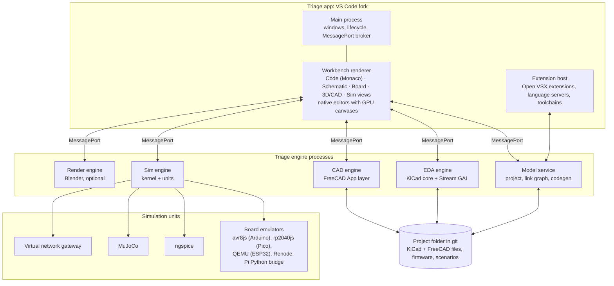
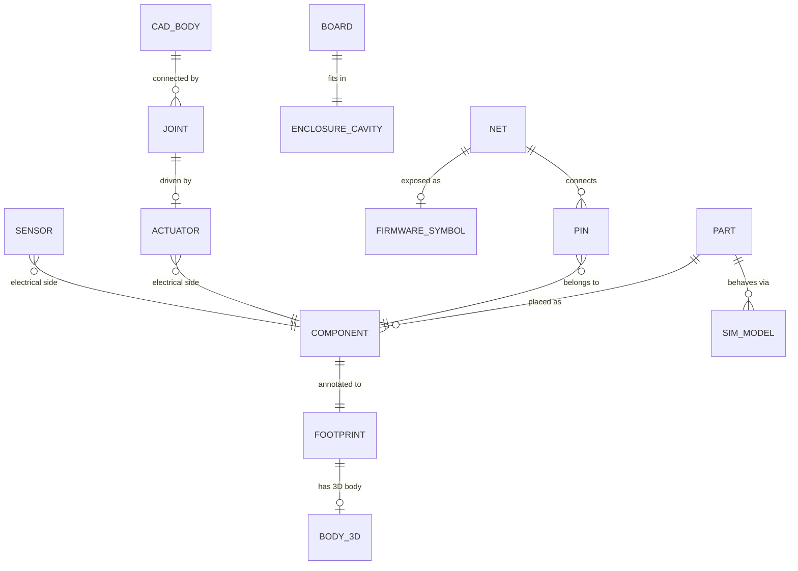
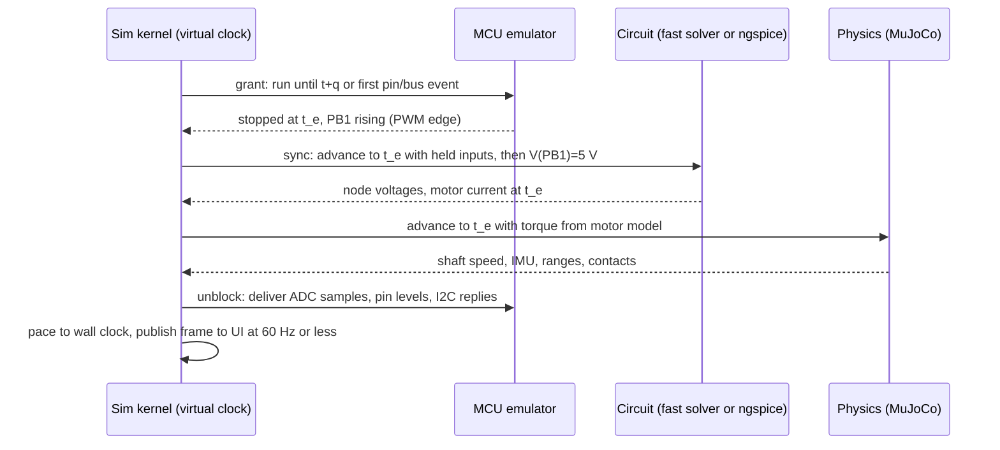
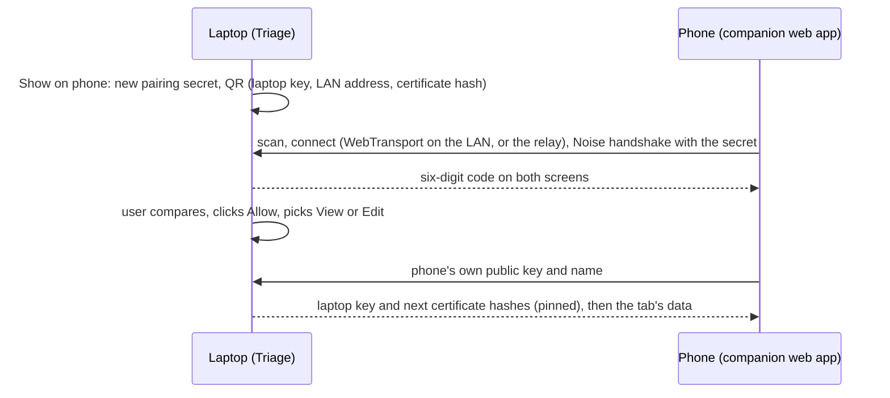

# Triage: master plan (standalone app)

> **Triage** is the product name (the owner's choice, 2026-11-24).
> Status: **plan v0.3**, 2026-11-24: the owner's answers applied (one window,
> simulation together or separately, ESP32/Arduino/Raspberry Pi, Windows first).
> Built from the unbounded teardown in
> [research/](research/README.md). Delivery: [ROADMAP.md](ROADMAP.md) · how we
> work: [GUIDELINES.md](GUIDELINES.md) · progress: [STATUS.md](STATUS.md).
> **Team:** the project owner and Claude.

---

## 0. The plan on one page

**What we're building.** A complete desktop app, **built from VS Code's own
source**, that does the work of VS Code, KiCad, a parametric CAD tool and
Blender in one window, and adds **whole-device simulation**. A student writes
firmware, draws the schematic, lays out the PCB and designs the enclosure side
by side, **as tabs of the same window**, on one linked project. **Run** then
executes the firmware on an emulated microcontroller, drives the simulated
circuit, and moves motors and reads sensors in a 3D physics world, with automated
tests that pass or fail. It can simulate **everything together or any part on its
own** (just the circuit, just the code, just the mechanism). Boards: **ESP32,
Arduino and Raspberry Pi**. It runs offline on a laptop, **Windows first**.

**Five big bets**

| # | Bet | Evidence |
|---|---|---|
| 1 | **Fork VS Code (Code-OSS) into the Triage app.** Native editors, new engine processes and our own layout are compiled into the workbench ([ADR 0001](adr/0001-standalone-app-on-vscode-codebase.md)) | VS Code's process model (utility processes + MessagePort, a narrow 26-member preload) is built for exactly this ([vscode.md](research/vscode.md)) |
| 2 | **Keep the engines, replace the UIs.** KiCad, FreeCAD and Blender become headless **engine processes** behind Triage's UI ([ADR 0002](adr/0002-absorb-engines-headless.md)) | KiCad's engine is 42–49% of its code and its graphics boundary is **68 methods**. FreeCAD splits **29.3 MB engine / 28.3 MB UI** ([kicad.md](research/kicad.md), [freecad.md](research/freecad.md)) |
| 3 | **Triage's own co-simulation kernel** wires MCU emulators, ngspice, MuJoCo and a virtual network together, with **wiring generated from the schematic and assembly** | ngspice `Init_Sync`/`SetBkpt`, MuJoCo `mjs_`/`mjcb_`, Renode's sync phases and `.repl` netlists, Wokwi's network gateway ([simulators.md](research/simulators.md)) |
| 4 | **One project, one link graph.** Pins, nets, parts, boards, bodies and code are linked across domains, so nothing is retyped or re-exported | the walkthrough below |
| 5 | **Build in vertical slices, inside one window from the start.** Each engine first appears as in-app views with simple edits, then gains full in-app editing. Stock KiCad and FreeCAD windows are only a temporary fallback | the owner's requirement (§1); a two-person team gets value early and retires risk step by step |

**Out of scope for v1.0** (guardrails against an infinite project): HDI/RF PCB
design · FEA/CFD beyond FreeCAD FEM basics · cloud accounts and collaboration ·
native mobile apps (the phone and tablet companion, §4.16, is a web app served by
the laptop's Triage). Blender's animation and VFX features stay inside the optional render engine.

**Confirmed with the owner (2026-11-24, §5):** everything integrated in one app;
simulation of everything together or any part separately; boards ESP32, Arduino
and Raspberry Pi ([ADR 0003](adr/0003-boards-and-windows.md)); a Windows laptop;
the name Triage; hidden engines ([ADR 0002](adr/0002-absorb-engines-headless.md)).

---

## 1. Who it's for and what it must do

**Users:** engineering students (EE, ME, mechatronics, CS), robotics and maker
clubs, capstone teams, and instructors who set and grade lab work. Many of them
work on **one small laptop screen**, so any tab can also be shown on their phone
or tablet (§4.16).

**Jobs to be done**
1. Design a device end to end without juggling 3–4 tools and manual exports.
2. **See it working before buying parts**: catch wiring, firmware, fit and power
   mistakes in simulation, for the whole device or one part at a time.
3. Hand off to manufacturing: Gerbers, BOM, pick-and-place, STEP, STL/3MF, firmware.
4. (Instructors) ship templates and auto-graded test scenarios.
5. **Check or continue the design on a phone or tablet** (the owner, 2026-11-25):
   the PCB, the 3D model or the running simulation, with simple edits, while the
   laptop does the work (§4.16).

**Principles:**
- **Everything in one window:** code, schematic, PCB, 3D and simulation are tabs of
  one app working on one project. No switching programs, no exporting between tools.
  Any tab can also be dragged out, or popped out with a button, into a **separate
  Triage window** (the owner, 2026-11-24): still Triage's own view of the same
  project, never the stock KiCad or FreeCAD window. **Show on phone** puts a tab on
  a paired phone or tablet the same way (§4.16).
- **Check together or separately:** simulate the whole device, or just the circuit,
  the code or the mechanism, whenever you like (§4.7).
- **One project, one truth, many views.**
- **Links, not exports.**
- **Progressive fidelity:** a game-like interactive sim by default, accurate
  engineering analysis one click away.
- **Open file formats:** KiCad and FreeCAD files stay openable in the original tools.
- **Teach through feedback:** errors explain physics.
- **Runs on a normal laptop:** Windows first (Linux and macOS too), 8–16 GB RAM,
  integrated GPU, offline.

---

## 2. What the full breakdown showed

| App | How it's really built (shipped builds, REA unbounded) | What Triage does with it |
|---|---|---|
| **VS Code 1.143** | Electron main process, sandboxed renderer, and utility processes (extension host, pty host, shared process, file watcher, **agent host**). One 26-member preload API. Renderers reach helpers over **MessagePort**. ~59 MB of core JS (two 21–22 MB workbench bundles) plus ~78 MB of built-in extensions | **Fork it.** Add Triage editors to the workbench and Triage engines as utility processes, using the same MessagePort pattern |
| **KiCad 10.0.8** | Launcher plus `KIFACE_1` plugins. ~158k functions, ~81 MB of code. pcbnew is **42% engine / 21% UI dialogs / 5% tools**. **GAL = 68 methods**. Router adapter `pns_kicad_iface.cpp`. Protobuf/nng API (15 protos). ngspice dlopen'd. OCCT for STEP. kicad-cli for every fab format | **EDA engine process** from KiCad source: **Stream GAL** for rendering, **remote tools** for editing, extended protobuf API, dialogs rebuilt in Triage |
| **FreeCAD 1.1** | Every module is an **App/Gui library pair**. Engine 29.3 MB (Part, PartDesign, Sketcher, Assembly + Ondsel solver, FEM, TechDraw, Materials). UI 28.3 MB (Qt + Coin3D) | **CAD engine process** (App layer + JSON-RPC). Triage draws the viewport and panels |
| **Blender 5.3** | 197 MB binary with embedded CPython. Cycles (Embree/HIP-RT/SYCL), OSL, USD, OpenVDB, Bullet, Mantaflow. UI is Python over RNA (273 panels, 505 menus, 348 Python operators) | **Optional render engine** (Cycles, mesh/sculpt) plus the **UX model** for Triage's 3D workspace |
| **Simulators** | ngspice co-sim hooks. simavr IRQ graph. avr8js/rp2040js cycle clocks. **Renode: 1,248 peripheral models, 143 CPU types, grant/sync/unblock/wait time phases**. MuJoCo 822-function API. **Wokwi: client-side emulation, a Go/WASM virtual network gateway, GDB and RFC2217 bridges** | **Sim engine** units and design patterns (§4.7) |

---

## 3. A walkthrough: building a smart desk fan

This is the target experience for v1.0. Earlier milestones deliver parts of it,
in the order of the [ROADMAP](ROADMAP.md).

1. **Open Triage → New Project → "Smart Fan (Arduino Uno)"** (the same template
   exists for ESP32 and Raspberry Pi Pico). It creates one folder with `firmware/`, `electronics/` (KiCad files), `mechanical/` (FreeCAD
   files) and `simulation/`. The window opens in the **Engineering layout**:
   Code | Schematic | Board | 3D | Sim.
2. **Electronics.** Maya places an NTC thermistor + 10 kΩ divider on A0, a
   logic-level MOSFET + flyback diode driving a 12 V fan on D9, an SSD1306 OLED on
   I²C and a button on D2. ERC runs live (KiCad's engine underneath).
3. **Code.** `#include "board_pins.h"` is generated from the schematic. Hovering
   `FAN_PWM` highlights the net. `analogWrite(10, …)` gets a squiggle: *"D10 is not
   connected to anything"*.
4. **PCB.** She places and routes the board in Triage's PCB editor, using KiCad's
   push-and-shove router underneath. The **3D view updates live inside the enclosure.**
5. **Mechanical.** "Enclosure from board" (FreeCAD engine): 2 mm walls, 5 mm
   clearance, **automatic cutouts** for USB and the DC jack, a fan grille, and
   **bosses at the board's mounting holes**. The fit check flags *"OLED header
   intersects lid by 1.2 mm"*, so she raises the lid.
6. **Run (F5).** The firmware compiles and the emulated ATmega328P boots. A
   room-temperature slider sits in the environment panel. At 35 °C, PWM reaches
   80% and **the fan spins in 3D**. **The OLED on the 3D model shows "35.0C 80%"**.
   A scope shows motor current. Next to Run, a **scope picker** runs just part of
   the device: earlier she used *Circuit only* to check the divider voltage before
   writing any code, and *Code only* (with a virtual I/O panel of LEDs, buttons and
   sliders) to test her menu logic before the board existed (§4.7).
7. **Accuracy tier.** She switches the power stage to SPICE and deletes the
   flyback diode. The scope shows a **61 V spike**, flagged *"exceeds MOSFET VDS max
   (55 V)"*.
8. **Debug.** A breakpoint in `updateFan()` **freezes CPU, circuit and physics
   together**. She steps through and watches the PWM pin.
9. **Test.** `simulation/scenarios/overheat.yaml` ramps 20 → 40 °C and expects duty
   ≥ 0.8 by 8 s and "HOT" on the OLED. It runs in the Test Explorer and as
   `triage test` in CI.
10. **Render and release.** A Cycles product shot from the render engine, then
    `triage export release` writes Gerbers, drill files, BOM and CPL, STEP, 3MF,
    `firmware.hex`, the test report and renders.

---

## 4. Architecture

### 4.1 System overview



### 4.2 Processes

| Process | Built from | Responsibilities | If it crashes |
|---|---|---|---|
| Main | VS Code fork | windows, lifecycle, menus. Spawns engines and hands **MessagePorts** to the renderer (the observed `ipcMessagePort.acquire` pattern) | app restarts |
| Workbench renderer | VS Code fork + Triage editors (TS) | Monaco, all Triage editors and panels, GPU canvases (WebGL2/WebGPU), workers for heavy client work | window reloads, state restored |
| Extension host | VS Code fork | Open VSX extensions, clangd, PlatformIO/arduino-cli/CMake tasks | extensions restart |
| **Model service** | Triage (Rust via napi-rs, in a utility process) | `triage.toml`, link graph, change propagation, pin-map codegen, scenario files | reconnect, reload from disk |
| **EDA engine** | **KiCad fork** (C++, headless) | schematic and board models, connectivity, router, DRC, zones, IO, plotters, simulator glue, jobs. **Stream GAL** display lists. **Remote tools**. Extended protobuf API | editors show "reconnecting", reload files |
| **CAD engine** | **FreeCAD fork** (C++/Python, App layer) | documents, features, sketches with solver, assemblies, materials, STEP/STL/3MF, FEM, TechDraw. Tessellation streaming. JSON-RPC | CAD ops retry |
| **Sim engine** | Triage (Rust kernel via napi-rs + Node utility process for the JS emulators) | scheduler, signal bus, units, scopes and stubs, recording/replay. Spawns QEMU (ESP32), Renode and the Raspberry Pi Python bridge | simulation stops with an error |
| **Render engine** | Blender (`blender -b` + Triage RPC script), optional | Cycles renders, mesh/sculpt operations, glTF/USD exchange | render job fails, retry |
| **Companion broker** (PC, proposed: [ADR 0005](adr/0005-phone-companion.md)) | Triage (Rust `triage-companion` via napi-rs, in a utility process) | paired phones and tablets: WebTransport server on the LAN, optional relay client, pairing, keys, permissions; relays the phone's requests to the window's engine services (§4.16) | phones show "reconnecting" |

**Transport.** Engines are native executables. A small Node **broker** in each
engine's utility process speaks to its engine over a local socket (KiCad's nng for
the EDA engine; named pipes on Windows, Unix sockets elsewhere) and relays to the renderer over MessagePort with **transferable
ArrayBuffers**. Control uses JSON-RPC or protobuf. Bulk data uses binary frames:
display lists, tessellations, waveforms.

### 4.3 How each original app is absorbed

Everything the user does happens in Triage's tabs, from the first release. Each
domain moves through two stages, and each stage ships:

| Stage | Electronics (KiCad) | Mechanical (FreeCAD) | Render (Blender) |
|---|---|---|---|
| **1. Engine + in-app views** (P1, P2) | **EDA engine** built from KiCad source. **Stream GAL** renders schematic and board inside Triage tabs, pixel-identical, with live selection and cross-probe. Simple edits (move, rotate, values, place, wire, track) through engine commits | **CAD engine** (FreeCAD App layer) inside Triage: live tessellated 3D, feature tree, properties, enclosure from board, fit checks | – |
| **2. Full in-app editing** (P5, P6, P8) | KiCad's interactive tools run headlessly (select, move, wire, place, **route** with push-and-shove, zones), as **remote tools** or by **hosting** them directly (spike P1-6, ADR 0004). Dialogs rebuilt in Triage | Triage sketcher overlay and feature UI over FreeCAD's solver. Assemblies with joints feed MuJoCo | render engine bundled with Triage, render queue panel; mesh/sculpt handoff with stable IDs |

**Temporary fallback, not a workflow.** Until stage 2 covers an edit, "Edit in
KiCad" or "Edit in FreeCAD" opens the same files in the stock editor window, and
Triage reloads them on save (§4.4, external edits). The fallback leaves the default
UI once P5 and P6 land. Exports and checks (fab outputs, STEP, ERC/DRC) always run
inside the engines, never in a separate program the user has to open.

**Stream GAL details** (from [kicad.md](research/kicad.md)): implement the ~45 drawing
methods of `KIGFX::GAL` (lines, segments, arcs, circles, polygons, curves, glyphs,
bitmaps, groups, layers, transforms) as a recorder that emits **display lists
per cached group**. The renderer composes layers on the GPU, and KiCad's own
`VIEW` caching decides what to redraw. **Remote tools:** convert canvas
mouse/keyboard events into KiCad `TOOL_EVENT`s and run the tool framework on the
engine's main loop. Tools that open wx dialogs are wrapped so the dialog becomes
a Triage form over the API. **Direct hosting** is the alternative the teardown
points to: some tools have clean adapters, such as the push-and-shove router behind
`pns_kicad_iface.cpp`, so the engine can host the router itself and feed it cursor
positions from Triage, without the wx tool framework. **Driving KiCad's tools
headlessly is the main technical risk**, so both paths get an early spike (ROADMAP
P1-6). The spike proposes direct hosting: KiCad's tools are built on a `wxFrame`,
while its router, commits and connectivity run headless in the engine
([ADR 0004](adr/0004-editing-path.md), proposed).

### 4.4 The unified project model

```
smart-fan/
  triage.toml                 # manifest: name, targets, boards, sim defaults
  firmware/                  # PlatformIO / Arduino / CMake / Zephyr / MicroPython
    src/main.cpp
    generated/board_pins.h   # generated from the schematic (do not edit)
  electronics/               # a normal KiCad project (.kicad_pro/.kicad_sch/.kicad_pcb)
  mechanical/                # FreeCAD documents (.FCStd) + exports/
  simulation/
    environment.toml         # temperature, light, gravity, obstacles, network
    scopes/*.toml            # saved scopes: which parts run, how the rest is stubbed
    scenarios/*.yaml         # stimulus + expectations (tests)
  parts/                     # project-local smart parts
  .triage/links.json          # cross-domain link graph (stable IDs)
```

- **Source of truth per domain:** KiCad files (electronics), FreeCAD files
  (mechanical), source code (firmware), YAML/TOML (simulation). Each opens in
  its original tool.
- **One schema, many uses** (Blender's RNA lesson): entity types (component, net,
  pin, board, body, joint, actuator, sensor, scenario, parameter) are defined
  once. From that we generate TS/Rust/Python API types, property panels,
  validation, undo records and docs.
- **Link graph:**



- **Stable IDs:** KiCad UUIDs for symbols, footprints and nets; FreeCAD object
  names and UUIDs for bodies and features; UUIDv7 for Triage entities.
- **Change propagation:** edits are commands. Dependents recompute through a
  small dependency graph. Renaming net `FAN_PWM` updates `board_pins.h`, the
  generated Renode `.repl`, scenarios and 3D labels in one transaction.
- **Parameters:** a project table (`board_w`, `wall`) usable in KiCad (board
  outline), FreeCAD (Spreadsheet), firmware (generated) and simulation.
- **External edits** (a file changed in stock KiCad or FreeCAD): watch, re-parse,
  reconcile links by ID, and list broken links in a Links problems view.

### 4.5 Cross-domain features (why Triage exists)

1. **Pin map sync:** a generated header, devicetree overlay or Python module, plus
   diagnostics for unknown, unconnected or misused pins.
2. **Cross-probe everywhere:** code ↔ schematic ↔ board ↔ 3D ↔ simulation.
3. **Board ↔ enclosure:** outline, holes and connectors drive CAD features.
   Interference and clearance checks use OCCT.
4. **Live 3D:** the board sits in the enclosure and updates on every edit.
5. **Mechatronics:** motors, servos and sensors are one smart part with
   electrical, mechanical and simulation sides.
6. **Run:** build firmware, assemble the co-simulation from schematic, assembly
   and environment, then play in 3D with instruments.
7. **Debug the world:** a breakpoint pauses CPU, circuit and physics together.
8. **Test:** scenario files hold stimulus plus expectations, run in the Test
   Explorer and CI.
9. **Check together or separately:** run the whole device or any part of it, and
   get ERC, DRC, fit and pin checks continuously while designing (§4.7).
10. **Release bundle:** fab, mechanical, firmware, BOM with cost, test report and renders.

### 4.6 Smart parts

```
parts/hc-sr04/
  part.toml          # metadata, pins, parameters, UI controls (sliders), datasheet
  symbol / footprint / 3D model   (KiCad library refs or files)
  sim/behavior.wasm  # Part SDK model: pins, timers, I2C/SPI/UART devices, framebuffer
  sim/spice.lib      # optional SPICE subcircuit for the accuracy tier
  mech.toml          # mass, mounting frame, sensor frame, joint hooks
  firmware/          # optional driver hints
```

The **Part SDK** is Triage's own WebAssembly API (C, Rust or AssemblyScript) for
behavioral models. It covers pins, watches, timers, bus devices, analog outputs,
a framebuffer, **UI controls** and access to the physics frame for sensors. The
manifest shape (pins + controls + display) follows the pattern observed in
Wokwi's chip schema. Starter library: about 100 tested parts (LEDs, R/C/L,
buttons, pots, LDR, NTC, DHT22, HC-SR04, MPU-6050, SSD1306, servo, DC motor,
L298N/DRV8833, MOSFETs, relay, buzzer, WS2812). KiCad 10's remote-provider protocol
can serve them into stock KiCad too.

### 4.7 Simulation architecture

**Fidelity tiers**

| Tier | Electrical | Firmware | Mechanics | Target speed |
|---|---|---|---|---|
| **T0 Interactive** (default) | event-driven logic + fast MNA solver for small analog islands | cycle-accurate emulators | MuJoCo, 1 kHz | ≥ 1× real time |
| **T1 Accurate** | ngspice transient on selected islands, co-simulated | same | same | 0.05–1× real time |
| **T2 Analysis** | ngspice OP/DC/AC/noise/sweeps/Monte Carlo, offline | – | FEM via the CAD engine | batch |

**Simulation scopes: everything together, or any part on its own.** The owner
wants to check the design "together or separately, however I want". A **scope**
picks which parts of the device a run simulates. Everything outside it is replaced
by a **stub**, so any part can run alone.

| Scope | What runs | What stands in for the rest | Typical question |
|---|---|---|---|
| **Whole device** (default) | firmware on the emulated board + circuit + mechanics + environment | nothing | "Does my device work?" |
| **Circuit only** | the circuit solver: interactive (T0) with switches and sliders, or SPICE (T1/T2) | the MCU's pins become sources and probes you control | "Is the divider voltage right? Does the MOSFET survive?" |
| **Code only** | the emulated board and its firmware | a **virtual I/O panel**: LEDs, buttons, sliders, a serial terminal and smart-part devices (an OLED, a sensor) wired ideally to the pins; no circuit, no physics | "Does my menu logic work?" |
| **Mechanism only** | MuJoCo with the assembly | actuators driven by sliders or scripted profiles; sensors read out directly | "Does the arm reach? Does the robot tip over?" |
| **Custom** | any subset of units, for example firmware + circuit without physics | stubs on every connection that crosses the scope boundary | anything else |

Stubs come in a few kinds: **control** (a UI slider, switch or signal generator),
**hold** (a fixed value), **trace** (replays a signal recorded in an earlier run, so
a part sees exactly what the rest of the device fed it), **ideal** (an ideal
source, load or motor) and **open** (disconnected). The kernel builds the
co-simulation graph from the link graph, cuts it at the scope boundary and inserts
the stubs. Scopes can be saved:

```toml
# simulation/scopes/power-stage.toml
name = "Power stage only"
run  = ["circuit"]          # any of: firmware, circuit, mechanics, environment, parts
tier = "T1"                 # SPICE for this island
[stubs]
"net:FAN_PWM" = { kind = "control", signal = "pwm", duty = 0.8, freq_hz = 490 }
"part:M1"     = { kind = "ideal", model = "dc-motor" }
```

**Where a run starts:** the scope picker next to Run; "Simulate this" in each tab
(schematic → circuit only, code → code only, 3D → mechanism only, starting from the
selection); scenario files (the `scope:` key); and the CLI
(`triage sim run --scope power-stage`).

**Checks without running:** ERC, DRC, fit and clearance, pin conflicts and the
power budget run continuously in the background while you design, and report in
the Problems panel. **Edits during a run:** value changes (a resistor, an
environment slider) apply live in T0. Wiring, geometry and code changes rebuild
the run and replay its recorded inputs up to the same moment.

**Units.** Each engine is wrapped as a unit with an FMI-3-like contract:
`doStep(t, Δt) → reached | earlyReturn(t_e, events)`, plus event handling and
state save/restore.

| Unit | Engine | Notes |
|---|---|---|
| **Arduino** Uno, Nano, Mega 2560 (AVR) | avr8js | in the sim engine's Node helper. 22-bit PC support for the Mega is present [O] |
| **Raspberry Pi Pico** (RP2040), Nano RP2040 Connect | rp2040js | PIO, USB-CDC, MicroPython. No RP2350 (Pico 2) in 1.4.2 [O]: later (P7) |
| **ESP32**, ESP32-S3, ESP32-C3 (incl. Arduino Nano ESP32) | **QEMU** (Espressif fork, child process) + Triage **peripheral models** | The fork emulates the CPU, UART, flash, timers, crypto, TWAI, LEDC (ESP32 only) and a virtual Ethernet MAC, but **not** the GPIO matrix, I²C, SPI, RMT, Wi-Fi or Bluetooth [D]. Triage adds those models, wired to the kernel, and a **Wi-Fi shim** over the emulated Ethernet into the **virtual network gateway** (user-space TCP/IP + DHCP/DNS, like Wokwi's `wokwigw`) |
| **Raspberry Pi 4/5** (Linux, Python) | **Python bridge** (child process) | a gpiozero **pin factory** plus `RPi.GPIO`, `smbus2`, `spidev` and `pyserial` shims route the script's pins and buses to the kernel. The script runs on the laptop's Python, paced to virtual time (T0 timing). Full system (QEMU `raspi4b`) is a stretch goal |
| Arduino Uno R4, Nano 33 BLE, STM32, nRF52, RISC-V… | **Renode** (child process) | Uno R4 Minima and Nano 33 BLE board files ship with Renode 1.16.1 [O]. `.repl` generated from the netlist. Inject at sync points (`ExecuteInNearestSyncedState`-style). GPIO over its co-sim protocol |
| Circuit T0 | Triage Rust MNA + logic solver | analog islands, logic nets |
| Circuit T1 | ngspice shared library | `Init_Sync` external sources, `SetBkpt` lockstep, event nodes |
| Mechanics | MuJoCo | model built with `mjs_*` from the CAD assembly. Torques via `mjcb_control`/`mjcb_act_*` |
| Parts | Part SDK (WASM) | behavioral models |
| Environment | built-in | temperature, light, distance targets, gravity, wind, network |
| External | FMI 3.0 FMU | third-party models |

[O] observed in the shipped packages, [D] from vendor documentation. Details and
sources: [simulators.md](research/simulators.md) §7 and
[ADR 0003](adr/0003-boards-and-windows.md).

**Time and scheduling** (Renode's design, observed):
- **One virtual clock** in `int64` picoseconds.
- **Conservative quantum sync.** Event producers (MCUs) run first, up to the
  quantum end or their first output event (early return). Continuous units
  (circuit, physics) catch up with held inputs, the event is applied, and the
  loop repeats, in explicit **grant, sync and unblock phases**.
- **Sync on demand:** an ADC read pauses the MCU and advances the circuit exactly
  to *t*.
- **Adaptive quantum** from 1 ms down to 1 µs. Sleeping MCUs skip ahead, as
  rp2040js does.
- **Real-time pacing** with a visible speed ratio. Run as fast as possible,
  slow-mo, or single-step.



**Netlist partitioning** (real-time speed): digital nets are event-driven, buses
(I²C, SPI, UART) run at transaction level (like Renode's bus messages), and
analog islands go to the fast solver (T0) or ngspice (T1).

**Electro-mechanical coupling:**
- **DC motor:** `V = R·i + L·di/dt + Ke·ω` and `τ = Kt·i − b·ω` (plus gearing).
- **Servo:** pulse width → target angle → P-controller with a speed limit.
- **Stepper:** step pulses → angle increments, with stall detection.
- **Sensors:** an IMU from MuJoCo accelerometer and gyro sensors through an
  MPU-6050 register model; HC-SR04 from `mj_ray`; encoders as quadrature edges;
  limit switches from contacts.

**Instruments:** live 3D (LED glow ∝ current, OLED framebuffer on the 3D part,
spinning shafts, NeoPixels), oscilloscope, logic analyzer with I²C/SPI/UART decode,
serial terminal, plots, energy and current budget, and an event log.

**Bridges** (Wokwi lesson): a **GDB server** per emulated MCU (DAP in Triage's
debugger) and an **RFC2217 serial port**, so external tools see the simulated board.
Network-capable boards (ESP32) reach the **virtual network gateway**: DHCP and DNS,
NAT to the laptop's internet when the user allows it, port forwarding (open the
board's web page in a browser), and built-in MQTT and HTTP test servers.

**Determinism and replay:** seeded noise, and UI interactions recorded with
virtual timestamps. Any run replays exactly.

**Tests:**

```yaml
# simulation/scenarios/overheat.yaml
name: fan reacts to overheating
scope: whole-device          # or circuit, code, mechanism, or a saved scope
duration: 12s
environment: { temperature_C: { ramp: [20, 40], over: 10s } }
expect:
  - at: 8s
    that: pwm_duty(net: FAN_PWM) >= 0.8
  - within: [9s, 12s]
    that: oled(U3).text contains "HOT"
  - always: current(net: +12V) < 1.5A
```

### 4.8 Rendering and UI

| Surface | Choice |
|---|---|
| Workbench | VS Code's own UI framework, plus Triage parts (Engineering layout, project explorer, inspectors) |
| Schematic and board canvas | WebGL2 (WebGPU when available) renderer drawing **Stream GAL display lists** from the EDA engine: layers, cached groups, instancing |
| 3D | three.js (WebGPURenderer with a WebGL2 fallback), with **tessellation streamed** from the CAD engine and board models from the EDA engine |
| Inspectors and dialogs | Triage components generated from the schema (§4.4) |
| Plots | uPlot for waveforms; a WebGL logic analyzer |

### 4.9 Interop and file formats

| Need | Format | Via |
|---|---|---|
| Electronics | KiCad native files | EDA engine |
| Fabrication | Gerber X2, Excellon, IPC-2581, ODB++, BOM, CPL | EDA engine (kicad-cli jobs) |
| Imports | Altium, Allegro, CADSTAR, PADS, Eagle, EasyEDA, Fabmaster | EDA engine (KiCad's `pcb_io`, 3.2 MB of importers) |
| Mechanical | FreeCAD `.FCStd`, STEP AP214/AP242, IGES, STL, 3MF, glTF | CAD engine |
| ECAD↔MCAD with other CAD | STEP now, IDX later | EDA + CAD engines |
| Physics | MJCF/mjSpec, URDF export | sim engine |
| Co-sim models | FMI 3.0, SSP | sim engine |
| Renders | glTF/USD to Blender | render engine |
| Firmware | ELF/HEX/UF2, GDB RSP, DAP | toolchains, emulators |

### 4.10 Extensibility and automation

- **Extensions:** the whole Open VSX ecosystem. Triage exposes a `triage` API to
  extensions.
- **Python API** (`import triage`) for project, schematic, board, CAD, sim and test,
  in the spirit of `bpy` and `pcbnew`. It runs out of process.
- **CLI** `triage`: `build`, `sim run [--scope …]`, `test`, `erc`, `drc`, `export release`, headless for CI.
- **MCP server:** AI agents (including Claude during development) can query nets,
  run scenarios, read waveforms and take 3D screenshots.

### 4.11 Tech stack

| Layer | Choice |
|---|---|
| App shell | **VS Code fork** (TypeScript, Electron), Open VSX gallery |
| Triage UI | TypeScript inside the workbench; WebGL2/WebGPU; three.js |
| Model service and sim kernel | **Rust** (napi-rs into Node utility processes; wasm-bindgen for a future web build) |
| EDA engine | **KiCad fork** (C++17/20, CMake), headless target + Stream GAL + remote tools |
| CAD engine | **FreeCAD fork** (C++/Python, CMake), App layer + RPC server |
| Render engine | Blender release build, driven by Python scripts |
| Simulation | ngspice, MuJoCo, avr8js, rp2040js, QEMU (Espressif fork) + Triage peripheral models, Renode, Raspberry Pi Python bridge, virtual network gateway |
| Toolchains | arduino-cli and PlatformIO Core (AVR, Arduino-ESP32, Arduino-Pico), ESP-IDF, Pico SDK, MicroPython, Python 3 (Raspberry Pi), CMake + Arm GNU, Zephyr; clangd |
| Build | pnpm + Turborepo (TS), Cargo (Rust), CMake + Ninja + ccache (C++; MSVC on Windows), vcpkg (KiCad on Windows), LibPack or conda/pixi (FreeCAD on Windows), MSYS2 (QEMU on Windows), GitHub Actions matrix: **Windows and Linux from P0**, macOS by P8 |
| Tests | Vitest, Playwright for Electron, cargo test, KiCad/FreeCAD golden files, sim regression scenarios |

### 4.12 Repository layout

```
engineering-solution-/
  app/                  # the VS Code fork: upstream.json pin + Triage overlays (src/vs/triage/, resources/), product.json, patches/
  engines/
    eda/                # KiCad fork: upstream + patches/ + Triage additions (stream_gal/, remote_tools/, api/)
    cad/                # FreeCAD fork: upstream + patches/ + Triage RPC module
    qemu-esp32/         # Espressif QEMU fork: upstream + patches/ + Triage peripheral models
    render/             # Blender scripts and RPC
  crates/               # Rust: triage-model, triage-sim-kernel, triage-mna, triage-ngspice, triage-mujoco, triage-part-sdk, triage-companion
  companion/            # phone and tablet companion (§4.16, proposed): web/ (the installable phone web app), relay/ (optional relay)
  sim/                  # Node helper for JS emulators, QEMU and Renode adapters, Pi Python bridge, network gateway
  parts/                # smart part library + per-part scenarios
  cli/                  # `triage` CLI
  docs/                 # plan, roadmap, guidelines, status, ADRs, research
  scripts/              # dev environment, builds, research reproduction
```

Forks are kept as a **pinned upstream checkout plus a patch queue**: `upstream.json`
names the release tag and commit, the build checks it out into `upstream/`
(git-ignored), then applies `patches/*.patch` and Triage's overlay folders.
Triage-only code lives in separate folders, so upstream merges stay mechanical
(GUIDELINES §6).

### 4.13 Packaging

One installer per OS containing the app and all engines. **Windows first** (the
owner's laptop): a per-user installer built the way VS Code builds its "User
Setup" (Inno Setup, no admin rights needed), x64 first and arm64 later. Then Linux
(AppImage, deb) and macOS (dmg). Expect a large download (on the order of 1–2 GB
with engines and libraries). Optional components download on demand (Blender
render engine, ESP32 QEMU, Renode, Raspberry Pi Python packages). Auto-update via
the VS Code update mechanism pointed at Triage's release feed. Unsigned Windows
installers trigger SmartScreen warnings; signing needs a certificate, an owner
decision before P8.

### 4.14 Performance budgets

| Scenario | Budget (mid-range Windows laptop, integrated GPU) |
|---|---|
| Cold start to usable | ≤ 5 s (engines start lazily) |
| Schematic pan/zoom | 60 fps at 5k items |
| Board pan/zoom | 60 fps at 50k items |
| Interactive routing feedback | ≤ 16 ms per mouse move (router in the EDA engine) |
| 3D board + enclosure | 60 fps at 2M triangles |
| T0 sim: Uno-class MCU + ≤ 30 parts + ≤ 20 bodies | ≥ 1× real time on one core |
| T0 sim: ESP32 + ≤ 20 parts (QEMU) | ≥ 0.5× real time (measure early in P4) |
| T1 sim: ≤ 200 SPICE nodes | ≥ 0.1× real time |
| Typical project memory | ≤ 4 GB including engines |

### 4.15 Security

- Firmware runs **only inside emulators**. Part models are **WASM** (sandboxed).
- Engines are separate processes with narrow, schema-validated message contracts.
  The renderer keeps VS Code's sandbox and narrow preload.
- **Workspace Trust** gates building or running a cloned project's toolchain,
  scripts and part models. Raspberry Pi Python scripts run as ordinary processes on
  the laptop (they are the user's own code), so they are gated the same way.
- Release builds harden the Electron fuses VS Code leaves open (RunAsNode off,
  Inspect off) **once** Triage no longer needs `fork` for Node helpers (utility
  processes replace it).
- **Phone companion** (§4.16, proposed): off until the user picks Show on phone.
  A phone joins only by scanning a fresh QR code **and** the user confirming a
  matching code on the laptop; each phone has its own revocable key and a
  permission (view, or view and edit). Traffic is end-to-end encrypted (a relay
  only forwards sealed frames). A phone reaches only the engine and simulation
  commands its permission allows, schema-checked like engine messages: no
  files, terminal, tasks, extensions or settings. Untrusted workspaces are view
  only.

### 4.16 Phone and tablet companion

> **Proposed** in [ADR 0005](adr/0005-phone-companion.md) at the owner's request
> (2026-11-25); evidence in [research/companion.md](research/companion.md);
> delivered by ROADMAP phase **PC**. The laptop does all the work; the phone is
> one more Triage view of the open project.

**What the user does**
1. In the Schematic, Board, 3D or Sim tab, open **Show on phone** in the tab bar
   (a dropdown beside the tab's window button; also a command and a Triage
   sidebar button). It lists paired phones ("Show on Maya's iPhone") and **Pair a
   new phone…**.
2. **Pair a new phone** shows a QR code at once. It changes every 45 s and stops
   after about 5 minutes (**Show again** restarts it), as Signal's does.
3. The phone's camera opens the link. The first time, the page offers **Install**
   (Android) or **Add to Home Screen** (iOS) and continues in the installed app.
   iOS keeps an installed web app's storage apart from Safari's, so the app
   scans the QR again itself, or takes the 8-character code shown under it.
4. **Check 1:** both screens show the same six-digit code. **Check 2:** the user
   clicks **Allow** on the laptop, picks **View only** (the default) or **View and
   edit**, and may rename the phone.
5. The phone opens the tab that was picked and can switch to the project's other
   tabs. **Follow laptop** keeps it on the laptop's tab, camera and selection.
   Later the phone app reconnects by itself whenever Triage runs with the
   companion on: no QR, no prompt.



**What runs where**

| Laptop (Triage) | Phone or tablet (companion web app) |
|---|---|
| engines, files, project model, simulation | Triage's renderers and a touch UI; no engines, no files |
| companion broker: WebTransport server, relay client, pairing, keys, permissions (§4.2) | its own key, the laptop's pinned key and certificate hashes |
| the window's engine services answer phone requests: edits from either side go to the same engine document and undo history, and every view of that document refreshes | the cached app (service worker) and, optionally, the last views for looking at offline |

**What the phone shows** (never more than the laptop's tabs can do at the time)

| View | Streamed from the laptop | View permission | Edit permission |
|---|---|---|---|
| Schematic, Board (from P1) | Stream GAL display lists (`TDL1` chunks), `DocumentInfo`, layers, items, hit tests | pan, pinch zoom, layers, sheets, tap for reference, value and net, cross-probe with the laptop, net highlight | P1-6's simple edits: value, reference, move, rotate, delete, undo, redo, save |
| 3D (from P2) | tessellations and transforms from the CAD engine (P2-2) and the board model | orbit, pan, zoom, outliner, fit-check highlights | enclosure parameters (P2-4) |
| Sim (from P3) | signal values, scope samples, serial output and body transforms, at up to 30 Hz | watch the run, serial monitor, plots, 3D playback | Run, Pause, Step, Speed, scope picker, virtual I/O panel (buttons, sliders), environment panel; optionally the phone's tilt as a sensor input (iOS asks for motion permission) |
| Code | – | later: read-only files and pin-map diagnostics | not planned: code is edited on the laptop |
| Full editing (P5, P6) | same streams | same | stays on the laptop; the phone keeps the simple edits |

**Transport**

| Path | How | Needs |
|---|---|---|
| **Same network** (first) | WebTransport (HTTP/3 over QUIC) from the phone app to the laptop's LAN address. The laptop's certificate is self-signed (ECDSA P-256, renewed every 13 days, as browsers require under 2 weeks) and pinned with `serverCertificateHashes` from the QR: no warning page, no certificate authority, no internet. While connected, the laptop gives the phone the hashes of its next certificates, so a phone in regular use never needs a new QR | iOS / iPadOS 26.4+ or Chrome 100+; a Wi-Fi that lets the two reach each other |
| **Anywhere** (optional) | the laptop and the phone each open a WebSocket to a small **relay**, which forwards sealed frames between them and holds no keys (Signal's provisioning relay works this way) | a hosted relay (owner decision, ADR 0005); iOS 17+ |
| Fallback (only if PC-1 rules out WebTransport) | WebRTC data channel, signalled through the relay, with TURN | the relay and TURN |

Both paths carry one **companion protocol** inside an end-to-end **Noise** session:
`IKpsk2` when pairing (the phone knows the laptop's key from the QR, and the QR's
secret is the pre-shared key), `IK` with the pinned keys when reconnecting;
X25519, AES-GCM and SHA-256, all in WebCrypto. On the LAN this runs inside TLS
pinned to the laptop's certificate, so a relay or a LAN path look the same to
the rest of the code. Frames are the engine connection's (u32 length, u8 type,
payload; `engineProtocol.ts`). Payloads are protobuf, `triage.companion.v1`, which
wraps `triage.eda.v1` requests and later the CAD and simulation messages.
Display-list chunks are split for the wire.

**Pairing in detail**
1. The QR holds `https://<companion origin>/p#<payload>`. Browsers never send a URL
   fragment to the server, so the host never sees the payload. It holds about 150
   bytes: format version, pairing id (16 random bytes, also the relay mailbox), a
   one-time **pairing secret** (32 bytes), the laptop's public key, up to three LAN
   addresses with port, the current certificate hash, the tab to open and an
   expiry. It names no project or person: a QR on a projector can be photographed.
2. The phone app connects (LAN first, then the relay if one is set up) and runs
   the handshake. Without the QR nobody can complete it, and the laptop's key is
   checked against the QR, so nobody can sit in between.
3. Both screens show six digits derived from the handshake, as KDE Connect's
   verification key and Signal's safety numbers do. The user compares them and
   clicks **Allow** with a permission. Five failed attempts end that QR, and each
   secret admits one phone.
4. The phone keeps a non-extractable WebCrypto key in the installed app's
   storage. The laptop stores the phone's public key, name, permission and
   dates in Triage's settings, and its own keys in VS Code's secret storage
   (Electron `safeStorage`: DPAPI on Windows).
5. **Fallback:** an 8-character code under the QR, typed on the phone, meets the
   laptop through the relay. A password-authenticated key exchange (WhatsApp's
   option 2; Magic Wormhole uses SPAKE2) leaves an attacker one guess.
6. **Revoke:** the Triage sidebar lists phones (name, permission, last seen) with
   **Remove**, which ends the session at once. A phone unused for 30 days pairs
   again (WhatsApp's signed device lists expire after 35 days). The phone app has
   **Unlink**.

**Laptop side**
- `app/src/vs/triage/browser/companion/`: the Show on phone dropdown on Triage's
  editors, the QR dialog (drawn locally), the Phones section of the Triage
  sidebar, a status bar item for connected phones, a notification when a phone
  connects, and phone edits labeled in the undo history.
- `app/src/vs/triage/node/companionBrokerMain.ts`: the utility process, with
  `crates/triage-companion` (Rust, napi-rs, built from source with Cargo on Windows
  and Linux: QUIC and WebTransport, certificates, Noise, QR payloads, relay client).
- Settings: companion on or off, LAN address and port, relay, default permission,
  and "keep the laptop awake while a phone is connected" (Electron's
  `powerSaveBlocker`; `code tunnel` keeps the computer awake the same way).

**Phone side** (`companion/web/`): TypeScript bundled with esbuild into a static
site with a web app manifest, a service worker (offline app shell, versioned),
Triage's icons (`scripts/branding/icons.py`), a JavaScript QR decoder (iOS has no
`BarcodeDetector`) and a strict content security policy. It imports
`edaRenderer.ts`, `displayList.ts`, `protobuf.ts`, `engineApi.generated.ts` and
`engineProtocol.ts` unchanged; none of them imports VS Code. **Rule for later
WPs:** the 3D view (P2-3) and the instruments (P3-5) keep their drawing code free
of VS Code imports too, so the phone app can bundle it. **Relay**
(`companion/relay/`, optional): a stateless WebSocket forwarder keyed by mailbox
id, with frame-size, rate and idle limits, no accounts and no content logs.

**Phone limits to design around** ([companion.md](research/companion.md) §2): iOS
26.4+ for the direct path; installed iOS web apps keep their own storage (pair
inside the installed app); no Web Bluetooth, WebUSB or Web Serial on iOS, so the
phone never talks to a real board; the camera in an installed iOS web app needs
testing on real phones; a phone may suspend the app in the background, so it
reconnects and asks for a fresh view when it returns.

**Targets** (measured in PC-1 on the owner's phone, then added to §4.14): first view
within 3 s of scanning on the same Wi-Fi; the Smart Fan board and 3D model at
≥ 30 fps on a mid-range phone; an edit round trip within 150 ms on the LAN;
simulation updates at 30 Hz on the LAN and 10 Hz through a relay.

---

## 5. Decisions

| # | Decision | Status |
|---|---|---|
| D1 | **Host:** standalone app built from VS Code's source ([ADR 0001](adr/0001-standalone-app-on-vscode-codebase.md)) | **confirmed** |
| D2 | **Team:** the owner + Claude, working in session-sized work packages ([GUIDELINES](GUIDELINES.md)) | **confirmed** |
| D3 | **Engines:** KiCad, FreeCAD and Blender run hidden as engines behind Triage's tabs; their UIs are replaced ([ADR 0002](adr/0002-absorb-engines-headless.md)) | **confirmed** 2026-11-24 |
| D4 | **Boards:** Arduino Uno/Nano first (P3); then ESP32/S3/C3 with simulated Wi-Fi, Raspberry Pi Pico and Raspberry Pi 4/5 Python projects (P4); then Arduino Uno R4 and Nano 33 BLE via Renode (P7) ([ADR 0003](adr/0003-boards-and-windows.md)) | **confirmed** 2026-11-24 (owner: ESP32, Arduino, Raspberry Pi) |
| D5 | **Platform:** Windows first-class from P0 (the owner's laptop); Linux for development and CI; macOS by P8 ([ADR 0003](adr/0003-boards-and-windows.md)) | **confirmed** 2026-11-24 |
| D6 | **Core languages:** TypeScript (UI), Rust (model, kernel, solvers), C++ (forked engines), C (QEMU peripheral models) | proposed |
| D7 | **License:** GPL-3.0-or-later for the combined app (compatible with everything reused; no further license work) | default |
| D8 | **Name:** Triage | **confirmed** 2026-11-24 |
| D9 | **Integration:** everything in one window, with any tab poppable into a separate Triage window (§1); stock KiCad/FreeCAD windows only as a temporary fallback (§4.3); simulation scopes for checking together or separately (§4.7) | **confirmed** 2026-11-24 (the owner's requirement; separate windows added by the owner the same day, DV-14) |
| D10 | **Editing path** for KiCad's interactive tools: remote tools vs direct hosting | **proposed** 2026-11-25 from the P1-6 spike: direct hosting, Triage owns the tool front ends ([ADR 0004](adr/0004-editing-path.md)); the owner decides |
| D11 | **Phone and tablet companion:** a web app paired by QR code that views, and with permission edits, any tab while the laptop does the work; WebTransport on the LAN, an optional relay elsewhere (§4.16, [ADR 0005](adr/0005-phone-companion.md)) | **proposed** 2026-11-25 (the owner's request); the owner decides |

## 6. Risks and mitigations

| Risk | Impact | Mitigation |
|---|---|---|
| **Scope**: three huge apps plus simulation, built by two | fatal | Vertical slices, absorb one engine at a time, in-app views before full in-app editing, strict out-of-scope list |
| **KiCad's tools headless**: tools are coupled to wx frames and dialogs | high | Early spike (P1-6) of remote tools vs direct hosting. Fallback: the stock KiCad window for complex tools while viewing and simple edits stay in-app |
| **Four forks to maintain** (VS Code, KiCad, FreeCAD, Espressif QEMU) | medium | Patch queues, Triage code in separate folders, scheduled upstream merges, REA version diffs to spot API changes |
| **Native build complexity** (four native engines on Windows and Linux, macOS later) | high | Windows and Linux in CI from P0, macOS by P8. Pin dependency versions, aggressive ccache, prebuilt dependency bundles (vcpkg, LibPack) |
| **ESP32 peripherals and Wi-Fi**: Espressif's QEMU lacks the GPIO matrix, I²C, SPI, RMT and Wi-Fi [D] | high | Triage writes those models (P4-1); Wi-Fi via a shim over the emulated Ethernet, chosen by a spike (P4-2); measure speed early |
| **Windows specifics**: paths, file locking, named pipes, antivirus slowdowns, SmartScreen | medium | Windows CI from the first commit; the owner tries nightlies; per-user install; signing decision before P8 |
| **Raspberry Pi Linux boards are full computers** | medium | The Python bridge covers typical course projects (GPIO, PWM, I²C, SPI, UART); full-system QEMU is a stretch goal (P7) |
| **Co-sim speed and stability** | high | Netlist partitioning, transaction-level buses, adaptive quanta, tiers, CI benchmarks |
| **Installer size and RAM use** | medium | Lazy engine start, optional components, per-engine memory budgets |
| **Running third-party binaries in cloud dev sessions may be blocked by policy**, and sessions run Linux only | low | Build engines from source in sessions. CI runs the Windows builds, and the owner tests nightlies on their laptop |
| **Phone companion** (§4.16): a listening port and edits from another device; phone browsers' limits (iOS 26.4+ for WebTransport, Windows firewall rules for a per-user app, Wi-Fi that isolates devices) | medium | Off by default, QR plus a confirmed code, per-phone revocable keys and permissions, end-to-end encryption, fuzzed protocol parser; the PC-1 spike tests real phones and the owner's Windows laptop before anything else is built; the relay and WebRTC as fallbacks |

## 7. Glossary

- **Code-OSS:** VS Code's open-source codebase (`microsoft/vscode`). Triage forks it.
- **Engine process:** a headless build of KiCad, FreeCAD or Blender (or Triage's sim kernel) behind Triage's UI.
- **Stream GAL:** a KiCad graphics backend that records drawing calls into display lists for Triage's canvas.
- **Remote tools:** KiCad's interactive tool framework driven by input from Triage's canvas.
- **kiface:** a KiCad editor module (`KIFACE_1` entry point).
- **Fallback window:** opening the same files in stock KiCad or FreeCAD for an edit Triage can't do yet. Temporary.
- **Simulation scope:** which parts of the device a run simulates (whole device, circuit, code, mechanism or custom).
- **Stub:** what stands in for a part outside the scope: a control, a held value, a recorded trace, an ideal model, or an open connection.
- **Peripheral models (ESP32):** Triage's C models of ESP32 peripherals that Espressif's QEMU lacks, wired to the sim kernel.
- **Pin factory:** gpiozero's plug-in point for pin drivers. Triage's routes a Raspberry Pi script's pins into the simulation.
- **Virtual network gateway:** a user-space network (DHCP, DNS, NAT, test servers) for simulated network boards.
- **Quantum:** the slice of virtual time units may run ahead before synchronizing.
- **Smart part:** one component with symbol, footprint, 3D, simulation and mechanical data.
- **T0/T1/T2:** interactive, accurate and analysis simulation tiers.
- **Companion:** Triage's phone and tablet web app, paired with the laptop by QR code; it shows Triage's tabs and sends edits to the laptop's engines (§4.16).
- **Relay (companion):** an optional server that forwards sealed frames between a phone and a laptop on different networks; it holds no keys.
