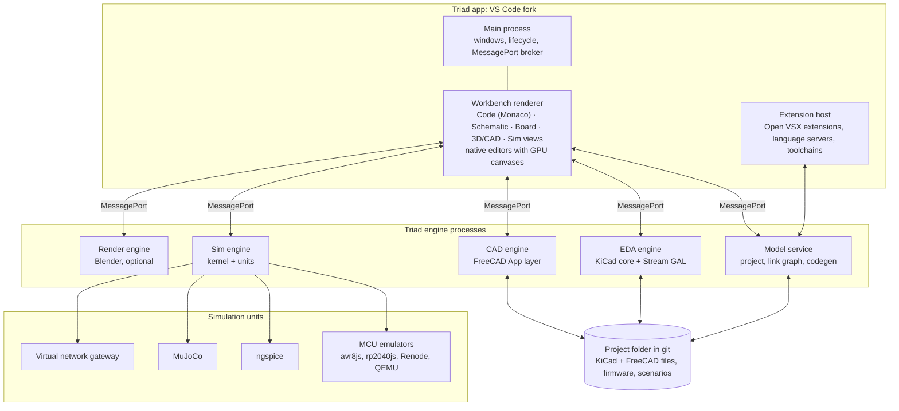
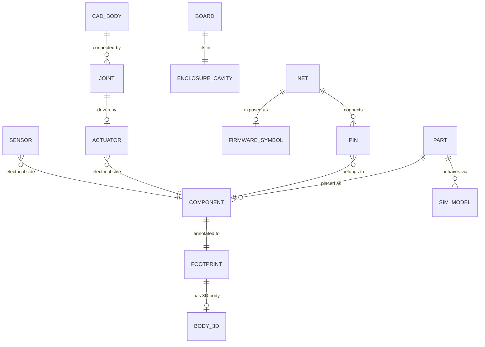
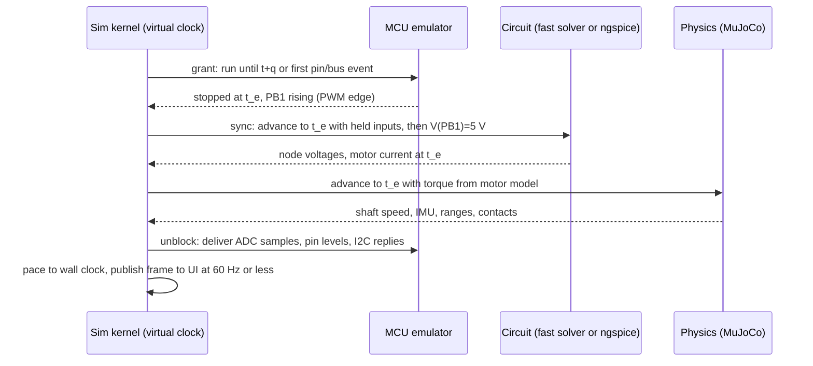

# Triad: master plan (standalone app)

> **Triad** is a working name for the three pillars (Code · Circuit · Form) plus
> the simulation that joins them. Rename freely.
> Status: **plan v0.2**, 2026-11-23. Built from the unbounded teardown in
> [research/](research/README.md). Delivery: [ROADMAP.md](ROADMAP.md) · how we
> work: [GUIDELINES.md](GUIDELINES.md) · progress: [STATUS.md](STATUS.md).
> **Team:** the project owner and Claude.

---

## 0. The plan on one page

**What we're building.** A complete desktop app, **built from VS Code's own
source**, that does the work of VS Code, KiCad, a parametric CAD tool and
Blender in one window, and adds **whole-device simulation**. A student writes
firmware, draws the schematic, lays out the PCB and designs the enclosure side
by side. **Run** then executes the firmware on an emulated microcontroller,
drives the simulated circuit, and moves motors and reads sensors in a 3D
physics world, with automated tests that pass or fail. It runs offline on a
laptop.

**Five big bets**

| # | Bet | Evidence |
|---|---|---|
| 1 | **Fork VS Code (Code-OSS) into the Triad app.** Native editors, new engine processes and our own layout are compiled into the workbench ([ADR 0001](adr/0001-standalone-app-on-vscode-codebase.md)) | VS Code's process model (utility processes + MessagePort, a narrow 26-member preload) is built for exactly this ([vscode.md](research/vscode.md)) |
| 2 | **Keep the engines, replace the UIs.** KiCad, FreeCAD and Blender become headless **engine processes** behind Triad's UI ([ADR 0002](adr/0002-absorb-engines-headless.md)) | KiCad's engine is 42–49% of its code and its graphics boundary is **68 methods**. FreeCAD splits **29.3 MB engine / 28.3 MB UI** ([kicad.md](research/kicad.md), [freecad.md](research/freecad.md)) |
| 3 | **Triad's own co-simulation kernel** wires MCU emulators, ngspice, MuJoCo and a virtual network together, with **wiring generated from the schematic and assembly** | ngspice `Init_Sync`/`SetBkpt`, MuJoCo `mjs_`/`mjcb_`, Renode's sync phases and `.repl` netlists, Wokwi's network gateway ([simulators.md](research/simulators.md)) |
| 4 | **One project, one link graph.** Pins, nets, parts, boards, bodies and code are linked across domains, so nothing is retyped or re-exported | the walkthrough below |
| 5 | **Build in vertical slices, companion first.** Ship a working end-to-end slice early using the stock apps as companions, then absorb each engine | two-person team: value early, risk retired step by step |

**Out of scope for v1.0** (guardrails against an infinite project): HDI/RF PCB
design · FEA/CFD beyond FreeCAD FEM basics · cloud accounts and collaboration ·
mobile. Blender's animation and VFX features stay inside the optional render engine.

**Open questions for you** (§5): which **laptop OS** you test on, which **first
boards** your courses use, and the **name**.

---

## 1. Who it's for and what it must do

**Users:** engineering students (EE, ME, mechatronics, CS), robotics and maker
clubs, capstone teams, and instructors who set and grade lab work.

**Jobs to be done**
1. Design a device end to end without juggling 3–4 tools and manual exports.
2. **See it working before buying parts**: catch wiring, firmware, fit and power
   mistakes in simulation.
3. Hand off to manufacturing: Gerbers, BOM, pick-and-place, STEP, STL/3MF, firmware.
4. (Instructors) ship templates and auto-graded test scenarios.

**Principles:**
- **One project, one truth, many views.**
- **Links, not exports.**
- **Progressive fidelity:** a game-like interactive sim by default, accurate
  engineering analysis one click away.
- **Open file formats:** KiCad and FreeCAD files stay openable in the original tools.
- **Teach through feedback:** errors explain physics.
- **Runs on a normal laptop:** 8–16 GB RAM, integrated GPU, offline.

---

## 2. What the full breakdown showed

| App | How it's really built (shipped builds, REA unbounded) | What Triad does with it |
|---|---|---|
| **VS Code 1.143** | Electron main process, sandboxed renderer, and utility processes (extension host, pty host, shared process, file watcher, **agent host**). One 26-member preload API. Renderers reach helpers over **MessagePort**. ~59 MB of core JS (two 21–22 MB workbench bundles) plus ~78 MB of built-in extensions | **Fork it.** Add Triad editors to the workbench and Triad engines as utility processes, using the same MessagePort pattern |
| **KiCad 10.0.8** | Launcher plus `KIFACE_1` plugins. ~158k functions, ~81 MB of code. pcbnew is **42% engine / 21% UI dialogs / 5% tools**. **GAL = 68 methods**. Router adapter `pns_kicad_iface.cpp`. Protobuf/nng API (15 protos). ngspice dlopen'd. OCCT for STEP. kicad-cli for every fab format | **EDA engine process** from KiCad source: **Stream GAL** for rendering, **remote tools** for editing, extended protobuf API, dialogs rebuilt in Triad |
| **FreeCAD 1.1** | Every module is an **App/Gui library pair**. Engine 29.3 MB (Part, PartDesign, Sketcher, Assembly + Ondsel solver, FEM, TechDraw, Materials). UI 28.3 MB (Qt + Coin3D) | **CAD engine process** (App layer + JSON-RPC). Triad draws the viewport and panels |
| **Blender 5.3** | 197 MB binary with embedded CPython. Cycles (Embree/HIP-RT/SYCL), OSL, USD, OpenVDB, Bullet, Mantaflow. UI is Python over RNA (273 panels, 505 menus, 348 Python operators) | **Optional render engine** (Cycles, mesh/sculpt) plus the **UX model** for Triad's 3D workspace |
| **Simulators** | ngspice co-sim hooks. simavr IRQ graph. avr8js/rp2040js cycle clocks. **Renode: 1,248 peripheral models, 143 CPU types, grant/sync/unblock/wait time phases**. MuJoCo 822-function API. **Wokwi: client-side emulation, a Go/WASM virtual network gateway, GDB and RFC2217 bridges** | **Sim engine** units and design patterns (§4.7) |

---

## 3. A walkthrough: building a smart desk fan

This is the target experience for v1.0. Earlier milestones deliver parts of it,
in the order of the [ROADMAP](ROADMAP.md).

1. **Open Triad → New Project → "Smart Fan (Arduino Uno)".** It creates one
   folder with `firmware/`, `electronics/` (KiCad files), `mechanical/` (FreeCAD
   files) and `simulation/`. The window opens in the **Engineering layout**:
   Code | Schematic | Board | 3D | Sim.
2. **Electronics.** Maya places an NTC thermistor + 10 kΩ divider on A0, a
   logic-level MOSFET + flyback diode driving a 12 V fan on D9, an SSD1306 OLED on
   I²C and a button on D2. ERC runs live (KiCad's engine underneath).
3. **Code.** `#include "board_pins.h"` is generated from the schematic. Hovering
   `FAN_PWM` highlights the net. `analogWrite(10, …)` gets a squiggle: *"D10 is not
   connected to anything"*.
4. **PCB.** She places and routes the board in Triad's PCB editor, using KiCad's
   push-and-shove router underneath. The **3D view updates live inside the enclosure.**
5. **Mechanical.** "Enclosure from board" (FreeCAD engine): 2 mm walls, 5 mm
   clearance, **automatic cutouts** for USB and the DC jack, a fan grille, and
   **bosses at the board's mounting holes**. The fit check flags *"OLED header
   intersects lid by 1.2 mm"*, so she raises the lid.
6. **Run (F5).** The firmware compiles and the emulated ATmega328P boots. A
   room-temperature slider sits in the environment panel. At 35 °C, PWM reaches
   80% and **the fan spins in 3D**. **The OLED on the 3D model shows "35.0C 80%"**.
   A scope shows motor current.
7. **Accuracy tier.** She switches the power stage to SPICE and deletes the
   flyback diode. The scope shows a **61 V spike**, flagged *"exceeds MOSFET VDS max
   (55 V)"*.
8. **Debug.** A breakpoint in `updateFan()` **freezes CPU, circuit and physics
   together**. She steps through and watches the PWM pin.
9. **Test.** `simulation/scenarios/overheat.yaml` ramps 20 → 40 °C and expects duty
   ≥ 0.8 by 8 s and "HOT" on the OLED. It runs in the Test Explorer and as
   `triad test` in CI.
10. **Render and release.** A Cycles product shot from the render engine, then
    `triad export release` writes Gerbers, drill files, BOM and CPL, STEP, 3MF,
    `firmware.hex`, the test report and renders.

---

## 4. Architecture

### 4.1 System overview



### 4.2 Processes

| Process | Built from | Responsibilities | If it crashes |
|---|---|---|---|
| Main | VS Code fork | windows, lifecycle, menus. Spawns engines and hands **MessagePorts** to the renderer (the observed `ipcMessagePort.acquire` pattern) | app restarts |
| Workbench renderer | VS Code fork + Triad editors (TS) | Monaco, all Triad editors and panels, GPU canvases (WebGL2/WebGPU), workers for heavy client work | window reloads, state restored |
| Extension host | VS Code fork | Open VSX extensions, clangd, PlatformIO/arduino-cli/CMake tasks | extensions restart |
| **Model service** | Triad (Rust via napi-rs, in a utility process) | `triad.toml`, link graph, change propagation, pin-map codegen, scenario files | reconnect, reload from disk |
| **EDA engine** | **KiCad fork** (C++, headless) | schematic and board models, connectivity, router, DRC, zones, IO, plotters, simulator glue, jobs. **Stream GAL** display lists. **Remote tools**. Extended protobuf API | editors show "reconnecting", reload files |
| **CAD engine** | **FreeCAD fork** (C++/Python, App layer) | documents, features, sketches with solver, assemblies, materials, STEP/STL/3MF, FEM, TechDraw. Tessellation streaming. JSON-RPC | CAD ops retry |
| **Sim engine** | Triad (Rust kernel via napi-rs + Node utility process for the JS emulators) | scheduler, signal bus, units, recording/replay. Spawns Renode and QEMU | simulation stops with an error |
| **Render engine** | Blender (`blender -b` + Triad RPC script), optional | Cycles renders, mesh/sculpt operations, glTF/USD exchange | render job fails, retry |

**Transport.** Engines are native executables. A small Node **broker** in each
engine's utility process speaks to its engine over a local socket (KiCad's nng for
the EDA engine) and relays to the renderer over MessagePort with **transferable
ArrayBuffers**. Control uses JSON-RPC or protobuf. Bulk data uses binary frames:
display lists, tessellations, waveforms.

### 4.3 How each original app is absorbed

Every domain moves through three stages. Each stage is shippable.

| Stage | Electronics (KiCad) | Mechanical (FreeCAD) | Render (Blender) |
|---|---|---|---|
| **A. Companion** | Triad launches stock KiCad for editing. `kicad-cli` provides netlist, ERC/DRC, GLB/STEP, fab outputs. IPC API cross-probing | Triad launches stock FreeCAD. `FreeCADCmd` scripts generate enclosures and export STEP/GLB | `blender -b` scripts render product shots |
| **B. Engine + viewer** | **EDA engine** built from KiCad source. **Stream GAL** renders schematic and board inside Triad tabs, pixel-identical, with live selection and cross-probe | **CAD engine** (FreeCAD App) inside Triad: live tessellated 3D, feature tree, properties | render engine bundled with Triad, render queue panel |
| **C. Native editing** | **Remote tools:** Triad canvas input drives KiCad's tool framework (select, move, wire, place, **route** with push-and-shove, zones). Dialogs rebuilt in Triad. KiCad window optional | Triad sketcher overlay and feature UI over FreeCAD's solver. Assemblies with joints feed MuJoCo | mesh/sculpt handoff with stable IDs |

**Stream GAL details** (from [kicad.md](research/kicad.md)): implement the ~45 drawing
methods of `KIGFX::GAL` (lines, segments, arcs, circles, polygons, curves, glyphs,
bitmaps, groups, layers, transforms) as a recorder that emits **display lists
per cached group**. The renderer composes layers on the GPU, and KiCad's own
`VIEW` caching decides what to redraw. **Remote tools:** convert canvas
mouse/keyboard events into KiCad `TOOL_EVENT`s and run the tool framework on the
engine's main loop. Tools that open wx dialogs are wrapped so the dialog becomes
a Triad form over the API. **This bridge is the main technical risk**, so it gets
an early spike (ROADMAP P3).

### 4.4 The unified project model

```
smart-fan/
  triad.toml                 # manifest: name, targets, boards, sim defaults
  firmware/                  # PlatformIO / Arduino / CMake / Zephyr / MicroPython
    src/main.cpp
    generated/board_pins.h   # generated from the schematic (do not edit)
  electronics/               # a normal KiCad project (.kicad_pro/.kicad_sch/.kicad_pcb)
  mechanical/                # FreeCAD documents (.FCStd) + exports/
  simulation/
    environment.toml         # temperature, light, gravity, obstacles, network
    scenarios/*.yaml         # stimulus + expectations (tests)
  parts/                     # project-local smart parts
  .triad/links.json          # cross-domain link graph (stable IDs)
```

- **Source of truth per domain:** KiCad files (electronics), FreeCAD files
  (mechanical), source code (firmware), YAML/TOML (simulation). Each opens in
  its original tool.
- **One schema, many uses** (Blender's RNA lesson): entity types (component, net,
  pin, board, body, joint, actuator, sensor, scenario, parameter) are defined
  once. From that we generate TS/Rust/Python API types, property panels,
  validation, undo records and docs.
- **Link graph:**



- **Stable IDs:** KiCad UUIDs for symbols, footprints and nets; FreeCAD object
  names and UUIDs for bodies and features; UUIDv7 for Triad entities.
- **Change propagation:** edits are commands. Dependents recompute through a
  small dependency graph. Renaming net `FAN_PWM` updates `board_pins.h`, the
  generated Renode `.repl`, scenarios and 3D labels in one transaction.
- **Parameters:** a project table (`board_w`, `wall`) usable in KiCad (board
  outline), FreeCAD (Spreadsheet), firmware (generated) and simulation.
- **External edits** (a file changed in stock KiCad or FreeCAD): watch, re-parse,
  reconcile links by ID, and list broken links in a Links problems view.

### 4.5 Cross-domain features (why Triad exists)

1. **Pin map sync:** a generated header, devicetree overlay or Python module, plus
   diagnostics for unknown, unconnected or misused pins.
2. **Cross-probe everywhere:** code ↔ schematic ↔ board ↔ 3D ↔ simulation.
3. **Board ↔ enclosure:** outline, holes and connectors drive CAD features.
   Interference and clearance checks use OCCT.
4. **Live 3D:** the board sits in the enclosure and updates on every edit.
5. **Mechatronics:** motors, servos and sensors are one smart part with
   electrical, mechanical and simulation sides.
6. **Run:** build firmware, assemble the co-simulation from schematic, assembly
   and environment, then play in 3D with instruments.
7. **Debug the world:** a breakpoint pauses CPU, circuit and physics together.
8. **Test:** scenario files hold stimulus plus expectations, run in the Test
   Explorer and CI.
9. **Release bundle:** fab, mechanical, firmware, BOM with cost, test report and renders.

### 4.6 Smart parts

```
parts/hc-sr04/
  part.toml          # metadata, pins, parameters, UI controls (sliders), datasheet
  symbol / footprint / 3D model   (KiCad library refs or files)
  sim/behavior.wasm  # Part SDK model: pins, timers, I2C/SPI/UART devices, framebuffer
  sim/spice.lib      # optional SPICE subcircuit for the accuracy tier
  mech.toml          # mass, mounting frame, sensor frame, joint hooks
  firmware/          # optional driver hints
```

The **Part SDK** is Triad's own WebAssembly API (C, Rust or AssemblyScript) for
behavioral models. It covers pins, watches, timers, bus devices, analog outputs,
a framebuffer, **UI controls** and access to the physics frame for sensors. The
manifest shape (pins + controls + display) follows the pattern observed in
Wokwi's chip schema. Starter library: about 100 tested parts (LEDs, R/C/L,
buttons, pots, LDR, NTC, DHT22, HC-SR04, MPU-6050, SSD1306, servo, DC motor,
L298N/DRV8833, MOSFETs, relay, buzzer, WS2812). KiCad 10's remote-provider protocol
can serve them into stock KiCad too.

### 4.7 Simulation architecture

**Fidelity tiers**

| Tier | Electrical | Firmware | Mechanics | Target speed |
|---|---|---|---|---|
| **T0 Interactive** (default) | event-driven logic + fast MNA solver for small analog islands | cycle-accurate emulators | MuJoCo, 1 kHz | ≥ 1× real time |
| **T1 Accurate** | ngspice transient on selected islands, co-simulated | same | same | 0.05–1× real time |
| **T2 Analysis** | ngspice OP/DC/AC/noise/sweeps/Monte Carlo, offline | – | FEM via the CAD engine | batch |

**Units.** Each engine is wrapped as a unit with an FMI-3-like contract:
`doStep(t, Δt) → reached | earlyReturn(t_e, events)`, plus event handling and
state save/restore.

| Unit | Engine | Notes |
|---|---|---|
| AVR (Uno, Nano) | avr8js | in the sim engine's Node helper |
| RP2040/RP2350 (Pico) | rp2040js | PIO, USB-CDC, MicroPython |
| STM32, nRF52, RISC-V… | **Renode** (child process) | `.repl` generated from the netlist. Inject at sync points (`ExecuteInNearestSyncedState`-style). GPIO over its co-sim protocol |
| ESP32 family | **QEMU** (Espressif fork, child process) | **virtual network gateway** for Wi-Fi/Internet (user-space TCP/IP + DHCP/DNS, like Wokwi's `wokwigw`) |
| Circuit T0 | Triad Rust MNA + logic solver | analog islands, logic nets |
| Circuit T1 | ngspice shared library | `Init_Sync` external sources, `SetBkpt` lockstep, event nodes |
| Mechanics | MuJoCo | model built with `mjs_*` from the CAD assembly. Torques via `mjcb_control`/`mjcb_act_*` |
| Parts | Part SDK (WASM) | behavioral models |
| Environment | built-in | temperature, light, distance targets, gravity, wind, network |
| External | FMI 3.0 FMU | third-party models |

**Time and scheduling** (Renode's design, observed):
- **One virtual clock** in `int64` picoseconds.
- **Conservative quantum sync.** Event producers (MCUs) run first, up to the
  quantum end or their first output event (early return). Continuous units
  (circuit, physics) catch up with held inputs, the event is applied, and the
  loop repeats, in explicit **grant, sync and unblock phases**.
- **Sync on demand:** an ADC read pauses the MCU and advances the circuit exactly
  to *t*.
- **Adaptive quantum** from 1 ms down to 1 µs. Sleeping MCUs skip ahead, as
  rp2040js does.
- **Real-time pacing** with a visible speed ratio. Run as fast as possible,
  slow-mo, or single-step.



**Netlist partitioning** (real-time speed): digital nets are event-driven, buses
(I²C, SPI, UART) run at transaction level (like Renode's bus messages), and
analog islands go to the fast solver (T0) or ngspice (T1).

**Electro-mechanical coupling:**
- **DC motor:** `V = R·i + L·di/dt + Ke·ω` and `τ = Kt·i − b·ω` (plus gearing).
- **Servo:** pulse width → target angle → P-controller with a speed limit.
- **Stepper:** step pulses → angle increments, with stall detection.
- **Sensors:** an IMU from MuJoCo accelerometer and gyro sensors through an
  MPU-6050 register model; HC-SR04 from `mj_ray`; encoders as quadrature edges;
  limit switches from contacts.

**Instruments:** live 3D (LED glow ∝ current, OLED framebuffer on the 3D part,
spinning shafts, NeoPixels), oscilloscope, logic analyzer with I²C/SPI/UART decode,
serial terminal, plots, energy and current budget, and an event log.

**Bridges** (Wokwi lesson): a **GDB server** per emulated MCU (DAP in Triad's
debugger) and an **RFC2217 serial port**, so external tools see the simulated board.

**Determinism and replay:** seeded noise, and UI interactions recorded with
virtual timestamps. Any run replays exactly.

**Tests:**

```yaml
# simulation/scenarios/overheat.yaml
name: fan reacts to overheating
duration: 12s
environment: { temperature_C: { ramp: [20, 40], over: 10s } }
expect:
  - at: 8s
    that: pwm_duty(net: FAN_PWM) >= 0.8
  - within: [9s, 12s]
    that: oled(U3).text contains "HOT"
  - always: current(net: +12V) < 1.5A
```

### 4.8 Rendering and UI

| Surface | Choice |
|---|---|
| Workbench | VS Code's own UI framework, plus Triad parts (Engineering layout, project explorer, inspectors) |
| Schematic and board canvas | WebGL2 (WebGPU when available) renderer drawing **Stream GAL display lists** from the EDA engine: layers, cached groups, instancing |
| 3D | three.js (WebGPURenderer with a WebGL2 fallback), with **tessellation streamed** from the CAD engine and board models from the EDA engine |
| Inspectors and dialogs | Triad components generated from the schema (§4.4) |
| Plots | uPlot for waveforms; a WebGL logic analyzer |

### 4.9 Interop and file formats

| Need | Format | Via |
|---|---|---|
| Electronics | KiCad native files | EDA engine |
| Fabrication | Gerber X2, Excellon, IPC-2581, ODB++, BOM, CPL | EDA engine (kicad-cli jobs) |
| Imports | Altium, Allegro, CADSTAR, PADS, Eagle, EasyEDA, Fabmaster | EDA engine (KiCad's `pcb_io`, 3.2 MB of importers) |
| Mechanical | FreeCAD `.FCStd`, STEP AP214/AP242, IGES, STL, 3MF, glTF | CAD engine |
| ECAD↔MCAD with other CAD | STEP now, IDX later | EDA + CAD engines |
| Physics | MJCF/mjSpec, URDF export | sim engine |
| Co-sim models | FMI 3.0, SSP | sim engine |
| Renders | glTF/USD to Blender | render engine |
| Firmware | ELF/HEX/UF2, GDB RSP, DAP | toolchains, emulators |

### 4.10 Extensibility and automation

- **Extensions:** the whole Open VSX ecosystem. Triad exposes a `triad` API to
  extensions.
- **Python API** (`import triad`) for project, schematic, board, CAD, sim and test,
  in the spirit of `bpy` and `pcbnew`. It runs out of process.
- **CLI** `triad`: `build`, `sim run`, `test`, `erc`, `drc`, `export release`, headless for CI.
- **MCP server:** AI agents (including Claude during development) can query nets,
  run scenarios, read waveforms and take 3D screenshots.

### 4.11 Tech stack

| Layer | Choice |
|---|---|
| App shell | **VS Code fork** (TypeScript, Electron), Open VSX gallery |
| Triad UI | TypeScript inside the workbench; WebGL2/WebGPU; three.js |
| Model service and sim kernel | **Rust** (napi-rs into Node utility processes; wasm-bindgen for a future web build) |
| EDA engine | **KiCad fork** (C++17/20, CMake), headless target + Stream GAL + remote tools |
| CAD engine | **FreeCAD fork** (C++/Python, CMake), App layer + RPC server |
| Render engine | Blender release build, driven by Python scripts |
| Simulation | ngspice, MuJoCo, avr8js, rp2040js, Renode, QEMU-ESP32, virtual network gateway |
| Toolchains | PlatformIO Core, arduino-cli, CMake + Arm GNU, ESP-IDF, Zephyr, MicroPython; clangd |
| Build | pnpm + Turborepo (TS), Cargo (Rust), CMake + Ninja + ccache (C++), GitHub Actions matrix |
| Tests | Vitest, Playwright for Electron, cargo test, KiCad/FreeCAD golden files, sim regression scenarios |

### 4.12 Repository layout

```
engineering-solution-/
  app/                  # the VS Code fork: upstream snapshot + Triad source under src/vs/triad/
  engines/
    eda/                # KiCad fork: upstream + patches/ + Triad additions (stream_gal/, remote_tools/, api/)
    cad/                # FreeCAD fork: upstream + patches/ + Triad RPC module
    render/             # Blender scripts and RPC
  crates/               # Rust: triad-model, triad-sim-kernel, triad-mna, triad-ngspice, triad-mujoco, triad-part-sdk
  sim/                  # Node helper for JS emulators, Renode/QEMU adapters, network gateway
  parts/                # smart part library + per-part scenarios
  cli/                  # `triad` CLI
  docs/                 # plan, roadmap, guidelines, status, ADRs, research
  scripts/              # dev environment, builds, research reproduction
```

Forks are kept as **upstream snapshot plus a patch queue** (`patches/*.patch`,
applied by script). Triad-only code lives in separate folders, so upstream merges
stay mechanical (GUIDELINES §6).

### 4.13 Packaging

One installer per OS (Windows, macOS, Linux; x64 and arm64) containing the app and
all engines. Expect a large download (on the order of 1–2 GB with engines and
libraries). Optional components download on demand (Blender render engine, ESP32
QEMU, Renode). Auto-update via the VS Code update mechanism pointed at Triad's
release feed.

### 4.14 Performance budgets

| Scenario | Budget (mid-range laptop, integrated GPU) |
|---|---|
| Cold start to usable | ≤ 5 s (engines start lazily) |
| Schematic pan/zoom | 60 fps at 5k items |
| Board pan/zoom | 60 fps at 50k items |
| Interactive routing feedback | ≤ 16 ms per mouse move (router in the EDA engine) |
| 3D board + enclosure | 60 fps at 2M triangles |
| T0 sim: Uno-class MCU + ≤ 30 parts + ≤ 20 bodies | ≥ 1× real time on one core |
| T1 sim: ≤ 200 SPICE nodes | ≥ 0.1× real time |
| Typical project memory | ≤ 4 GB including engines |

### 4.15 Security

- Firmware runs **only inside emulators**. Part models are **WASM** (sandboxed).
- Engines are separate processes with narrow, schema-validated message contracts.
  The renderer keeps VS Code's sandbox and narrow preload.
- **Workspace Trust** gates building or running a cloned project's toolchain,
  scripts and part models.
- Release builds harden the Electron fuses VS Code leaves open (RunAsNode off,
  Inspect off) **once** Triad no longer needs `fork` for Node helpers (utility
  processes replace it).

---

## 5. Decisions

| # | Decision | Status |
|---|---|---|
| D1 | **Host:** standalone app built from VS Code's source ([ADR 0001](adr/0001-standalone-app-on-vscode-codebase.md)) | **confirmed** |
| D2 | **Team:** the owner + Claude, working in session-sized work packages ([GUIDELINES](GUIDELINES.md)) | **confirmed** |
| D3 | **Engines:** absorb KiCad, FreeCAD and Blender headless; replace their UIs ([ADR 0002](adr/0002-absorb-engines-headless.md)) | proposed: confirm in session 1 |
| D4 | **First boards:** Arduino Uno (AVR) + Raspberry Pi Pico (RP2040); then STM32/nRF (Renode); then ESP32 (QEMU + network) | needs you: what do your courses use? |
| D5 | **Your laptop OS** (first installer we polish): Windows, macOS or Linux | **needs you** |
| D6 | **Core languages:** TypeScript (UI), Rust (model, kernel, solvers), C++ (forked engines) | proposed |
| D7 | **License:** GPL-3.0-or-later for the combined app (compatible with everything reused; no further license work) | default |
| D8 | **Name:** "Triad" placeholder | needs you |

## 6. Risks and mitigations

| Risk | Impact | Mitigation |
|---|---|---|
| **Scope**: three huge apps plus simulation, built by two | fatal | Vertical slices, companion mode first, absorb one engine at a time, strict out-of-scope list |
| **KiCad remote tools**: tools are coupled to wx frames and dialogs | high | Early spike (P3). Fallback: keep the KiCad editor window for complex tools while viewing and simple edits move in-app |
| **Three forks to maintain** (VS Code, KiCad, FreeCAD) | medium | Patch queues, Triad code in separate folders, scheduled upstream merges, REA version diffs to spot API changes |
| **Native build complexity** (KiCad and FreeCAD dependencies on 3 OSes) | high | Linux first in CI, then Windows and macOS. Pin dependency versions, aggressive ccache, prebuilt dependency bundles |
| **Co-sim speed and stability** | high | Netlist partitioning, transaction-level buses, adaptive quanta, tiers, CI benchmarks |
| **Installer size and RAM use** | medium | Lazy engine start, optional components, per-engine memory budgets |
| **Running third-party binaries in cloud dev sessions may be blocked by policy** | low | Build engines from source in sessions. The owner tests installers on their laptop |

## 7. Glossary

- **Code-OSS:** VS Code's open-source codebase (`microsoft/vscode`). Triad forks it.
- **Engine process:** a headless build of KiCad, FreeCAD or Blender (or Triad's sim kernel) behind Triad's UI.
- **Stream GAL:** a KiCad graphics backend that records drawing calls into display lists for Triad's canvas.
- **Remote tools:** KiCad's interactive tool framework driven by input from Triad's canvas.
- **kiface:** a KiCad editor module (`KIFACE_1` entry point).
- **Companion mode:** using stock KiCad, FreeCAD or Blender windows and CLIs before the engine is absorbed.
- **Quantum:** the slice of virtual time units may run ahead before synchronizing.
- **Smart part:** one component with symbol, footprint, 3D, simulation and mechanical data.
- **T0/T1/T2:** interactive, accurate and analysis simulation tiers.
