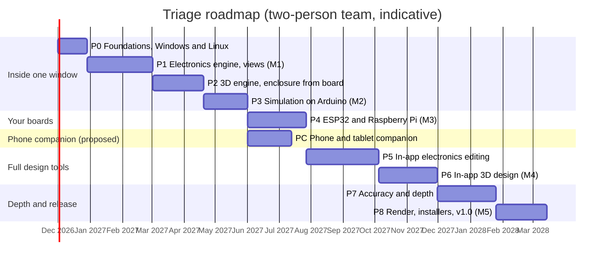

# Triage: roadmap (team of two: the owner + Claude)

How we get from an empty repository to the app in [PLAN.md](PLAN.md). Work is cut
into **work packages (WPs)** of about 1–3 Claude sessions each. Every WP ends with
something runnable and tested. [GUIDELINES.md](GUIDELINES.md) describes how a
session works, and [STATUS.md](STATUS.md) tracks where we are.

**Order of attack: inside one window from the start.** Everything the user does
happens in Triage's own tabs. Each engine first shows up as an **in-app view with
simple edits** (electronics in P1, 3D in P2), then the simulation joins them (P3),
then your other boards (P4), then **full in-app editing** (P5, P6). The stock KiCad
and FreeCAD windows are only a temporary fallback for edits Triage can't do yet
(PLAN §4.3). **Windows is first-class from P0**, because it's the owner's laptop.

| Milestone | When (indicative) | What you can do |
|---|---|---|
| **M1 "Circuit inside"** | end of P1, ~3 months | Open a KiCad project in Triage and see its **schematic and PCB in tabs**, drawn by KiCad's own engine. Make simple edits (move, rotate, change values, place a part, draw a wire). The code knows the pin map. The files still open in stock KiCad |
| **M2 "One window"** | end of P3, ~6 months | **The whole Smart Fan in one window:** circuit, board, a 3D enclosure generated from the board, and Arduino code. **Run** the whole device, or simulate **just the circuit, just the code or just the mechanism**. A scenario test passes |
| **PC "On your phone"** *(proposed, [ADR 0005](adr/0005-phone-companion.md))* | after M2, ~6 weeks beside P4 | Pick **Show on phone** beside a tab, scan the QR, confirm the code: the **schematic, PCB, 3D model and simulation** show on a phone or tablet (Android, iOS 26.4+), with simple edits and the simulation's controls. The laptop does the work |
| **M3 "Your boards"** | end of P4, ~8 months | The same on **ESP32** (with simulated Wi-Fi), **Raspberry Pi Pico**, and **Raspberry Pi** Python projects. A breakpoint freezes the whole simulated world |
| **M4 "Full design tools"** | end of P6, ~12 months | Draw any schematic and route a 2–4 layer board in Triage (push-and-shove router, zones, DRC). Model enclosures and mechanisms from scratch (sketches, features, assemblies that drive the physics) |
| **M5 "v1.0"** | end of P8, ~15 months | SPICE accuracy, more boards (Uno R4, Nano 33 BLE, STM32), ~100 smart parts, product renders, a polished Windows installer (Linux and macOS too) |

**What's inside the one window at each milestone**

| After | Code | Schematic | PCB | 3D | Simulation |
|---|---|---|---|---|---|
| M1 | edit, build, pin-map diagnostics | view, simple edits | view, simple edits | – | – |
| M2 | same | same | + simple tracks | view, enclosure from board, fit checks | Arduino Uno/Nano: whole device, circuit only, code only, mechanism only |
| M3 | + ESP32, Pico, Pi Python | same | same | same | + ESP32 with Wi-Fi, Pico, Raspberry Pi; debugging in the simulated world |
| M4 | same | full editing, ERC | full editing, push-and-shove routing, DRC, fab outputs | full parametric design, assemblies | assemblies drive physics |
| M5 | same | same | same | + renders | + SPICE accuracy, more boards, ~100 parts |

Durations assume steady work, several sessions a week. Independent WPs (for
example P4's ESP32 and Raspberry Pi items) can run in **parallel sessions on
separate branches** to go faster.

**Why Arduino before ESP32:** the owner listed ESP32 first, and it comes straight
after the first slice. Arduino Uno goes first because its emulator (avr8js) embeds
directly, so P3 can focus on the kernel and the one-window experience. ESP32 needs
extra emulator work (Espressif's QEMU has no GPIO matrix, I²C, SPI or Wi-Fi models;
[ADR 0003](adr/0003-boards-and-windows.md)).

---

## P0 · Foundations (Windows and Linux)

| WP | Deliverable | Done when |
|---|---|---|
| **P0-1** Repository skeleton | Folders from PLAN §4.12; pnpm + Turborepo, Cargo workspace, CMake presets; formatting and lint; CI matrix on **Windows and Linux** | CI green on both, on placeholder tests |
| **P0-2** VS Code fork imported | Upstream `microsoft/vscode` at a pinned release tag in `app/`; build scripts for Linux (`build.sh`) and Windows (`build.ps1`); Triage `product.json` (name, data folder, **Open VSX** gallery), placeholder branding | Running builds on Linux and Windows; a Playwright smoke test opens a window on both |
| **P0-3** Triage entry points + patch queue | `app/src/vs/triage/` contribution: Triage view container, **Engineering layout** (Code · Schematic · Board · 3D · Sim), walkthrough page. Patch-queue tooling (`patches/`, apply/refresh scripts) | Triage sidebar and layout visible; the patch queue re-applies cleanly onto a fresh upstream checkout |
| **P0-4** Engine connection pattern | A "hello engine" native process behind a utility-process broker; MessagePort to the renderer with transferable ArrayBuffers; crash and restart handling; throughput benchmark (PLAN §4.2) | Measured on Windows and Linux (target ≥ 100 MB/s of binary frames); a killed engine shows "reconnecting" and recovers |
| **P0-5** Project format v0 | `triage.toml` JSON Schema; `crates/triage-model` (load/validate), napi binding; project explorer (Code / Electronics / Mechanical / Simulation) | Opening `examples/smart-fan` shows the four domains; Rust and TS unit tests |
| **P0-6** Dev environment | `scripts/dev/setup.sh` (Linux) and `scripts/dev/setup.ps1` (Windows: Node, Python, Visual Studio Build Tools, Rust MSVC, CMake, Ninja), used by CI too | A fresh container and a fresh Windows CI runner both build following only the scripts |
| **P0-7** Windows nightlies | CI uploads Windows builds every night (portable zip first, then the per-user installer from VS Code's own Inno Setup build) and a Linux build | **Owner check:** the owner downloads the nightly and launches it on their Windows laptop |
| **P0-8** Triage's own GitHub sign-in *(added 2026-11-24 at the owner's request, DV-15)* | A GitHub OAuth app named **Triage**, registered by the owner (device flow on, no client secret); a patch puts its client ID into VS Code's GitHub sign-in (`extensions/github-authentication`); a test of whether GitHub Copilot accepts it | Signing in from the Windows build shows **Triage** on GitHub's page; whether Copilot works with it is recorded in STATUS, and if it doesn't, the owner has picked the fallback |
| **P0-9** Branding sweep *(added 2026-11-24 at the owner's request; P8-7 item 4 done early, DV-16)* | No VS Code name or logo in Triage's interface: Triage's icon replaces VS Code's logo and Code-OSS's icon and watermark (SVGs generated by `scripts/branding/icons.py`); the build rewrites "Visual Studio Code" and "VS Code" in interface text to the product name (`scripts/branding/rebrand.mjs`), keeping Microsoft product names (VS Code Speech, VS Code for the Web, Insiders) | The smoke test finds no VS Code name in the packaged interface text or the Welcome page, and Triage's icon in place of VS Code's logos |

## P1 · Electronics engine and in-app views → **M1**

| WP | Deliverable | Done when |
|---|---|---|
| **P1-1** KiCad fork builds | KiCad pinned release in `engines/eda/` with a patch queue; Linux (GCC) and **Windows (MSVC + vcpkg)** builds in CI with caching | `kicad-cli` built from our tree passes on the `kicad-demos` corpus on both OSes |
| **P1-2** Headless engine host | `triage-eda-engine`: long-running headless process, modeled on `kicad-cli` and KiCad's API server; loads projects; protobuf API over nng (Unix sockets on Linux, named pipes on Windows) | The engine loads all `kicad-demos` projects and answers API queries |
| **P1-3** Stream GAL | GAL backend recording the ~45 drawing methods into per-group display lists; binary protocol; headless `VIEW` + painters | Display lists for a demo board match OpenGL GAL output in a golden test |
| **P1-4** Schematic and board views | Triage editors drawing display lists (WebGL2): layers, pan/zoom, selection and hit-testing through the engine, cross-probe schematic ↔ board | Every demo project renders at 60 fps; pixel-compare against kicad-cli SVG/PNG |
| **P1-5** Link graph v0 + pin map | Components, nets and pins from the engine into the link graph; generated `board_pins.h`; editor diagnostics for unconnected or misused pins; code ↔ schematic cross-probe; Arduino Uno and Nano board profiles with arduino-cli / PlatformIO build tasks | Renaming a net updates the header and the diagnostics within 2 s |
| **P1-6** Simple edits + editing spike | Simple edits through engine commits: move, rotate, delete, change values and references, place a symbol or footprint, draw a wire or a track, undo/redo. **Spike** the paths for KiCad's interactive tools: **remote tools** (its tool framework) vs **direct hosting** (for example the router through `pns_kicad_iface.cpp`) | Files saved by Triage open correctly in stock KiCad; spike report + **ADR 0004** (editing path) |
| **P1-7** Fallback window | "Edit in KiCad" opens the same files in the stock KiCad editor for anything Triage can't edit yet; Triage reloads on save and keeps its links | A change saved in KiCad shows up in Triage's views within 2 s |

**M1 exit demo:** open the Smart Fan KiCad project in Triage, see schematic and
board in tabs, move a part, rename a net and watch `board_pins.h` and the code
diagnostics update. The files still open in stock KiCad. The owner runs it on
Windows.

## P2 · 3D engine and enclosure from board

| WP | Deliverable | Done when |
|---|---|---|
| **P2-1** FreeCAD fork builds | FreeCAD pinned release in `engines/cad/` (App layer, no GUI) on Linux and **Windows (LibPack or conda/pixi)** in CI | `FreeCADCmd` from our tree runs the Part/PartDesign tests on both OSes |
| **P2-2** CAD engine RPC | JSON-RPC server module: documents, recompute, feature tree, properties, tessellation streaming | Open and recompute every Smart Fan document over RPC |
| **P2-3** 3D view v0 | Native 3D editor (three.js): viewport with Blender-style navigation, outliner, properties, selection; the board's 3D model from the EDA engine; live refresh | Board and enclosure visible together; a board edit updates the 3D view |
| **P2-4** Enclosure from board | Parametric enclosure feature in the CAD engine: shell, lid, bosses at the mounting holes, connector cutouts from footprint positions; parameters edited in Triage's properties panel | The Smart Fan board gets a printable enclosure; changing the wall thickness recomputes live |
| **P2-5** Fit and clearance checks | OCCT interference and clearance between board, parts and enclosure; highlights in 3D; entries in the Problems panel | A deliberately tall part gets a red highlight and a problem entry |

## P3 · Simulation slice on Arduino → **M2**

| WP | Deliverable | Done when |
|---|---|---|
| **P3-1** Sim kernel core | `crates/triage-sim-kernel`: picosecond clock, unit trait, quantum scheduler (grant/sync/unblock), signal bus, record/replay, **scopes and stubs** (PLAN §4.7) | Deterministic replay test; scheduler property tests; each stub kind behaves as declared |
| **P3-2** AVR unit | avr8js in the sim engine's Node helper: Arduino Uno and Nano (ATmega328P); GPIO, ADC, PWM, UART, I²C and SPI ports; serial monitor panel | Blink and serial-echo sketches run at ≥ 1× real time |
| **P3-3** T0 circuit + first parts | Netlist partitioning; logic nets; Rust MNA solver for small analog islands; parts: LED, resistor, button, pot, NTC, MOSFET + DC motor, servo, SSD1306 | The thermistor divider reads the right ADC value; LED current is correct |
| **P3-4** Mechanics unit + 3D playback | `crates/triage-mujoco` (`mjs_*` model building, `mjcb_control` torques); fan rotor; frames drawn in the same 3D view at 60 Hz | Fan speed follows PWM; the LED glows in 3D |
| **P3-5** Run UX and scopes | Run / Pause / Step / Speed; **scope picker** (whole device, circuit only, code only, mechanism only, custom); **virtual I/O panel** for code-only runs; environment panel; instruments v0 (scope, plots, serial) | PLAN §3 step 6 works end to end, and each scope also runs on its own |
| **P3-6** Scenario tests | YAML v0 (`at`, `within`, `always`, `scope`), `triage test` CLI, Test Explorer, CI job on Windows and Linux | `overheat.yaml` passes headless in CI on both OSes |

**M2 exit demo:** PLAN §3 steps 1–6 and 9 inside Triage. The board uses simple
tracks (push-and-shove routing arrives in P5). The owner runs it on Windows.

## PC · Phone and tablet companion *(proposed: [ADR 0005](adr/0005-phone-companion.md), added 2026-11-25 at the owner's request, DV-20)*

Any Triage tab on a paired phone or tablet, through an installable web app
(PLAN §4.16). It comes **after M2**, when the schematic, board, 3D model and
simulation all exist to show. It runs **beside P4** in its own sessions (its WPs
touch none of P4's files, GUIDELINES §5), or between P3 and P4 if the owner
prefers one session at a time; then P4 onward move by about 6 weeks. PC-1 needs
only P1's views, so it can run earlier, during P2, if the owner wants the answer
sooner. Nothing here starts before the owner accepts ADR 0005.

| WP | Deliverable | Done when |
|---|---|---|
| **PC-1** Spike: a phone reaches the laptop | A throwaway spike: a small Rust WebTransport server in a utility process (built from source), a test page at a temporary HTTPS origin that draws one Smart Fan display list with `edaRenderer.ts`, on the owner's phones: direct WebTransport to the LAN address with the certificate hash pinned from a QR, the camera scan inside the installed web app, and the relay path if the owner wants one. Measures first-view time, throughput and frame rate; checks what Windows Defender Firewall asks for a per-user install. ADR 0005 updated with the results | **Owner check:** the owner scans the QR from the Windows build and sees the board drawn on their phone over the LAN. The numbers are in STATUS. The owner has accepted ADR 0005 with its open choices made (WebTransport or the WebRTC fallback; relay or not; the companion origin) |
| **PC-2** Companion broker and pairing | `crates/triage-companion` (QUIC and WebTransport, certificates renewed every 13 days with the next hashes handed out, Noise `IKpsk2` and `IK`, QR payloads) and `companionBrokerMain.ts`; pairing with a rotating QR, the six-digit code, **Allow** with a permission; paired phones with keys in secret storage, **Remove**; the **Show on phone** dropdown on Triage's tabs, the QR dialog, the Phones section of the Triage sidebar, a status bar item; settings; off by default | A test on Windows and Linux pairs a scripted phone (the phone app in a second Electron window with mobile emulation, so no extra browser download) with the packaged app, and checks that an expired or reused QR, a wrong code, a removed phone and an edit from a view-only phone are all refused. Fuzz tests of the protocol parser run in CI. Security review notes in STATUS |
| **PC-3** Phone app shell | `companion/web/`: web app manifest, service worker (offline shell), Install and Add to Home Screen guidance, in-app QR scanner and typed-code entry, pairing screens, **Unlink**, reconnect, tab switcher and **Follow laptop**; CI builds it and publishes it to the companion origin; the laptop refuses an incompatible app version with a clear message | Chrome's installability check passes in CI. **Owner check:** the owner installs the app on their phone, pairs it with the Windows nightly, restarts both, and it reconnects without a QR |
| **PC-4** Schematic and board on the phone | The WebGL2 display-list renderer in the phone app; touch pan, pinch zoom, layers and sheets; tap → engine hit test → item card; cross-probe both ways; with edit permission: value and reference, move, rotate, delete, undo, redo, save through the engine; every view of the document refreshes after an edit from either side | The Smart Fan board and schematic draw at ≥ 30 fps on the owner's phone. A value changed on the phone shows in the laptop's tab within 1 s, is in the saved file and opens in stock KiCad. A scripted-phone test runs in CI on both OSes |
| **PC-5** 3D on the phone | The 3D view's drawing code (P2-3) in the phone app; tessellations and transforms streamed; touch orbit, pan and zoom; outliner; fit-check highlights; with edit permission: enclosure parameters (P2-4) | Board and enclosure at ≥ 30 fps on the owner's phone; changing the wall thickness on the phone recomputes and updates both screens |
| **PC-6** Simulation on the phone | Run, Pause, Step, Speed and the scope picker; virtual I/O and environment panels; serial monitor and plots (P3-5's drawing code); 3D playback; state at up to 30 Hz with backpressure; the phone's tilt as an optional sensor input | **Owner check:** the owner starts the Smart Fan simulation from the phone, moves the room-temperature slider there, and the fan speeds up in the 3D views on both screens; the overheat scenario's result shows on the phone |
| **PC-7** Away from the desk + security review | If the owner chose a relay: `companion/relay/` and its deployment, used when the LAN path fails; pairing with the 8-character code through it; reconnect after network changes; frame-size, rate and idle limits. Either way: a threat model and security review of PC-2 to PC-7 (a QR on a projector, someone on the same Wi-Fi, the relay operator, a lost phone, the app's host), and a list of edits made from phones | With a relay: a phone on mobile data reaches the laptop on home Wi-Fi, and a test shows the relay sees only ciphertext. The security review is in STATUS with every item fixed or accepted by the owner |

**PC exit demo:** on the owner's Windows laptop, **Show on phone** on the Board tab,
pair a phone with the QR and the six-digit code, change a resistor's value on the
phone, then run the Smart Fan simulation from the phone and watch the fan spin in
3D on both screens. The files still open in stock KiCad.

## P4 · ESP32 and Raspberry Pi → **M3**

| WP | Deliverable | Done when |
|---|---|---|
| **P4-1** ESP32 unit | Espressif's QEMU fork built from source in `engines/qemu-esp32/` (Linux, Windows) for **ESP32 and ESP32-S3, then ESP32-C3**; Triage **peripheral models** for what it lacks (GPIO matrix/IOMUX, ADC, I²C, SPI, RMT, LEDC on S3/C3), wired to the kernel with virtual-time sync; Arduino-ESP32, ESP-IDF and MicroPython builds | Blink, button, ADC, I²C OLED and NeoPixel (RMT) sketches pass scenarios on ESP32 and ESP32-S3 |
| **P4-2** Network + simulated Wi-Fi | **Virtual network gateway** (DHCP, DNS, NAT to the laptop's internet when allowed, port forwarding, built-in MQTT and HTTP test servers). **Wi-Fi shim** so `WiFi.begin()` and `esp_wifi_*` connect to a virtual access point over QEMU's emulated Ethernet. Starts with a spike: link-time shim vs a register-level Wi-Fi model | An ESP32 sketch joins "Wi-Fi", publishes to the built-in MQTT broker and serves a web page the owner opens in a browser |
| **P4-3** RP2040 unit | rp2040js: Raspberry Pi Pico (and Arduino Nano RP2040 Connect); Pico SDK, Arduino-Pico and **MicroPython**; PIO; USB-CDC serial | A MicroPython blink + button script and an Arduino-Pico sketch pass scenarios |
| **P4-4** Raspberry Pi (Linux) bridge | Raspberry Pi 4/5 40-pin header part. Python bridge: a **gpiozero pin factory** plus `RPi.GPIO`, `smbus2`, `spidev` and `pyserial` shims that connect the script's pins and buses to the kernel. The script runs on the laptop's Python, paced to virtual time | A gpiozero LED + button script and an I²C sensor read work against the simulated circuit |
| **P4-5** Debug in the simulated world | **GDB server → DAP** for each emulated MCU (AVR, RP2040, ESP32); world pause on breakpoints; variable and peripheral views; RFC2217 serial bridge | A breakpoint in ESP32 or Pico firmware freezes physics and circuit; stepping advances them together |
| **P4-6** Board profiles + templates | Profiles: Uno, Nano, Mega 2560, ESP32 DevKitC, ESP32-S3 DevKit, ESP32-C3, Pico, Pi 4/5. Templates: Smart Fan for Uno, ESP32 (web dashboard over Wi-Fi) and Pico | New Project offers each board; every template's scenarios pass in CI |

**M3 exit demo:** the ESP32 Smart Fan serves its dashboard over simulated Wi-Fi;
the Pico version runs MicroPython; a Raspberry Pi gpiozero script drives the same
circuit. The owner runs all three on Windows.

## P5 · In-app electronics editing

| WP | Deliverable | Done when |
|---|---|---|
| **P5-1** Schematic editing | Symbol chooser, wires, buses, labels, junctions, hierarchical sheets, annotation, properties panel, undo/redo, on the path chosen in ADR 0004 | The Smart Fan schematic is drawn from scratch in Triage |
| **P5-2** ERC | Engine ERC in Triage's Problems panel; net highlighting | ERC results match `kicad-cli sch erc` |
| **P5-3** Placement + push-and-shove routing | Footprint placement, ratsnest, interactive router (walkaround, shove), vias, differential pairs, length tuning | The Smart Fan board is routed in Triage |
| **P5-4** Zones, rules, DRC | Zones with fill, net classes and a rules editor (Triage UI), DRC panel | DRC results match `kicad-cli pcb drc` |
| **P5-5** Libraries + smart parts browser | Symbol and footprint browsers over KiCad libraries; smart part browser | An HC-SR04 smart part is placed with its sim model attached |
| **P5-6** Dialogs rebuilt | Board setup, footprint and symbol properties, the fields table, and the other dialogs that 2–4 layer boards need | No template workflow needs the fallback window |
| **P5-7** Fab outputs | Jobsets in the engine; Triage release bundle | Gerbers open cleanly in a viewer; BOM/CPL correct |

## P6 · In-app 3D design → **M4**

| WP | Deliverable | Done when |
|---|---|---|
| **P6-1** Sketcher | Sketch overlay with constraints solved by FreeCAD's Sketcher | A fully constrained enclosure sketch is built in Triage |
| **P6-2** Part features | Pad, pocket, revolve, loft, fillet, chamfer, shell, hole, patterns, booleans | The Smart Fan enclosure is modeled from scratch in Triage |
| **P6-3** Blender-style workflow | Workspaces, search for every command (like Blender's F3), pie menus, modal move/rotate/scale (G/R/S), Blender and FreeCAD keymaps | The owner signs off a 10-task modeling checklist |
| **P6-4** Assemblies → physics | Assembly joints (Ondsel solver) → MuJoCo via `mjs_*`; motors and servos bound to smart parts | A 2-DOF arm moves under servo control in simulation |
| **P6-5** Board ↔ enclosure links | Parametric links (outline, holes, connectors) with live fit checks | Moving a connector on the board moves its cutout |

**M4 exit demo:** the whole PLAN §3 walkthrough, steps 1–6, with every edit made
in Triage and no fallback window.

## P7 · Accuracy and depth

| WP | Deliverable | Done when |
|---|---|---|
| **P7-1** ngspice T1/T2 | `crates/triage-ngspice` (`Init_Sync`, `SetBkpt`, event nodes); per-island tier switch; DC/AC/transient analyses; waveform viewer | The flyback-diode lesson (PLAN §3 step 7) reproduces |
| **P7-2** Renode boards | Renode unit: Arduino **Uno R4 Minima** (RA4M1) and **Nano 33 BLE** (nRF52840), whose board files ship with Renode; an STM32 Nucleo; `.repl` generated from the netlist; sync-point injection | Blink + button scenarios pass on each |
| **P7-3** Part SDK v1 + library | WASM SDK, ~100 parts with scenario tests; logic analyzer with I²C/SPI/UART decode | Part library CI green; protocol decode in the analyzer |
| **P7-4** Raspberry Pi full system (stretch) | QEMU `raspi4b`/`raspi3b` running Raspberry Pi OS, its GPIO bridged to the kernel; research an emulator for Pico 2 (RP2350), which rp2040js lacks | A C program using libgpiod blinks a simulated LED |
| **P7-5** FMI 3.0 import (stretch) | FMU unit | A Modelica-exported FMU runs in a scenario |

## P8 · Render, installers and v1.0 → **M5**

| WP | Deliverable | Done when |
|---|---|---|
| **P8-1** Render engine | Blender driven headless: product shots and turntables from the 3D assembly (glTF/USD with stable IDs) | The render queue produces images for the release bundle |
| **P8-2** Windows installer + updates | Per-user installer polished, optional components downloaded on demand, update feed; code signing if the owner gets a certificate | Installed on the owner's laptop, it auto-updates to the next nightly |
| **P8-3** Linux and macOS packages | AppImage/deb; macOS dmg (signing and notarization if the owner wants them) | The templates install and run on each |
| **P8-4** Templates + docs | Smart Fan (Uno, ESP32, Pico), Line Follower, Weather Station (ESP32 + Wi-Fi), Raspberry Pi Python starter; onboarding; user docs | A new user completes the Smart Fan in under 1 hour |
| **P8-5** Performance pass | PLAN §4.14 budgets measured and met on a mid-range Windows laptop | Benchmarks green in CI |
| **P8-6** Release 1.0 | Changelog, tagged release, known-issues list | v1.0 published (with the owner's OK) |
| **P8-7** Public release checklist *(added 2026-11-24 at the owner's request)* | Before builds go to anyone but the owner: **(1)** GitHub sign-in as Triage (done in P0-8); **(2)** Copilot: GitHub's service accepts Triage's sign-in (P0-8 test) **and** GitHub's terms allow Copilot in Triage (not yet checked), otherwise AI through the user's own API key; **(3)** Windows signing: certificate, Microsoft's cloud signing or the Microsoft Store (with P8-2); **(4)** Microsoft trademarks: no VS Code name or logo (done early in P0-9; re-check after each upstream update, and the built-in extensions' runtime messages); **(5)** extensions from Open VSX, never Microsoft's Marketplace (done in P0-2); **(6)** no data to Microsoft: no telemetry key in `product.json` (observed 2026-11-24) | Every item checked, with evidence, in STATUS before P8-6 |

---

## First session checklist

When the build starts in a new session:
1. Read `CLAUDE.md`, then this file and `STATUS.md`. The planning questions are
   answered; STATUS lists the defaults still worth confirming when they come up.
2. Start **P0-1** with CI on **Windows and Linux** from the first commit, then
   **P0-2**. The VS Code fork build on both OSes is the first big unknown, so
   retire it early.
