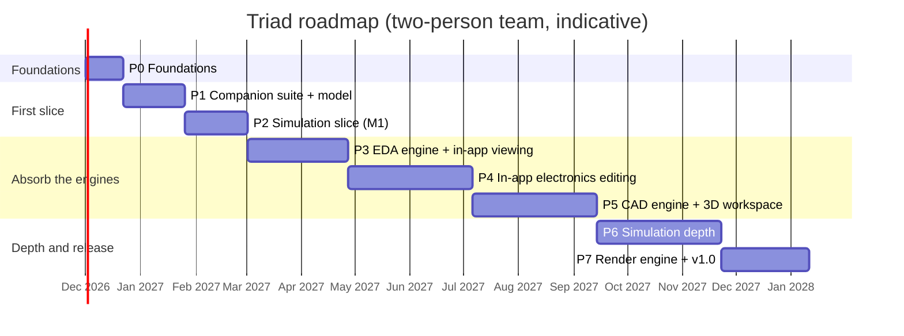

# Triad: roadmap (team of two: the owner + Claude)

How we get from an empty repository to the app in [PLAN.md](PLAN.md). Work is cut
into **work packages (WPs)** of about 1–3 Claude sessions each. Every WP ends with
something runnable and tested. [GUIDELINES.md](GUIDELINES.md) describes how a
session works, and [STATUS.md](STATUS.md) tracks where we are.

**Order of attack:** first a working end-to-end slice using stock KiCad and
FreeCAD as **companions**, then absorb each engine into Triad (electronics, then
CAD), then deepen simulation, then ship.

| Milestone | When (indicative) | What you can do |
|---|---|---|
| **M1 "It runs"** | end of P2, ~3 months | One Triad project. Edit the circuit in KiCad (companion), code in Triad, generate the enclosure, press **Run** and watch the fan spin in 3D, pass a scenario test |
| **M2 "Electronics inside"** | end of P4, ~7.5 months | Draw the schematic and lay out the board **inside Triad** with KiCad's engine (router, DRC, zones). KiCad still opens the files |
| **M3 "CAD inside"** | end of P5, ~10 months | Design enclosures and mechanisms **inside Triad** with FreeCAD's engine. Assemblies drive physics |
| **M4 "v1.0"** | end of P7, ~14 months | Accurate and broad simulation, renders, installers for Windows, macOS and Linux |

Durations assume steady work, several sessions a week. Independent WPs (for
example P5 and P6 items) can run in **parallel sessions on separate branches** to
go faster.

---

## P0 · Foundations

| WP | Deliverable | Done when |
|---|---|---|
| **P0-1** Repository skeleton | Folders from PLAN §4.12; pnpm + Turborepo, Cargo workspace, CMake presets; formatting and lint; CI on Linux | CI green on placeholder tests |
| **P0-2** VS Code fork imported | Upstream `microsoft/vscode` at a pinned release tag in `app/`, build script, Triad `product.json` (name, data folder, **Open VSX** gallery), placeholder branding | `scripts/app/build.sh` produces a running Linux build; a Playwright smoke test opens a window |
| **P0-3** Triad entry points | `app/src/vs/triad/` contribution: Triad view container, **Engineering layout** command, walkthrough page. Patch-queue tooling (`patches/`, apply/refresh scripts) | Triad sidebar visible; patch queue re-applies cleanly onto a fresh upstream checkout |
| **P0-4** Project format v0 | `triad.toml` JSON Schema; `crates/triad-model` (load/validate), napi binding; project explorer tree (Code / Electronics / Mechanical / Simulation) | Opening `examples/smart-fan` shows the four domains; Rust and TS unit tests |
| **P0-5** Dev environment | `scripts/dev/setup.sh` (Linux deps for app, Rust, later KiCad/FreeCAD), docs for the owner's OS | Fresh container to first build following only the script |
| **P0-6** Nightly artifacts | CI uploads a Linux build. Windows and macOS jobs start (may be red at first) | Owner can download and launch a nightly |

## P1 · Companion suite and project model

| WP | Deliverable | Done when |
|---|---|---|
| **P1-1** Companion manager | Detect KiCad, FreeCAD and Blender (path, version), settings UI, open-in-companion commands | Detects installs and opens the project's files in each |
| **P1-2** KiCad bridge | Protobuf/nng client for KiCad's IPC API, **cross-probe** (Triad ↔ KiCad selection), netlist via `kicad-cli sch export netlist`, file watching | Selecting a net in Triad highlights it in KiCad and vice versa |
| **P1-3** Link graph v0 + pin map | Components, nets and pins from the netlist into the link graph; generated `board_pins.h`; editor diagnostics for unconnected or misused pins | Renaming a net in KiCad updates the header and diagnostics within 2 s |
| **P1-4** Firmware build | PlatformIO/arduino-cli tasks, Uno and Pico board profiles, clangd config | Build and flash-image generation from Triad's Run menu |
| **P1-5** 3D assembly view v0 | Native workbench editor with three.js: board GLB (`kicad-cli pcb export glb`) + enclosure GLB, live refresh | Board and enclosure visible together; refresh on save |
| **P1-6** Enclosure from board v0 | FreeCADCmd script: parametric box/shell/lid, bosses at mounting holes, connector cutouts from footprint positions, fit check (OCCT interference) | Smart Fan board gets a printable enclosure and a red highlight on a collision |

## P2 · Simulation slice "Smart Fan Lite" → **M1**

| WP | Deliverable | Done when |
|---|---|---|
| **P2-1** Sim kernel core | `crates/triad-sim-kernel`: picosecond clock, unit trait, quantum scheduler (grant/sync/unblock), signal bus, record/replay | Deterministic replay test; scheduler property tests |
| **P2-2** AVR unit | avr8js in the sim engine's Node helper; GPIO, ADC, PWM, UART ports; serial monitor panel | Blink and serial-echo sketches run at ≥ 1× real time |
| **P2-3** T0 circuit + first parts | Netlist partitioning; logic nets; Rust MNA solver for small analog islands; parts: LED, button, pot, NTC, MOSFET + DC motor, servo | Thermistor divider reads the right ADC value; LED current is correct |
| **P2-4** MuJoCo unit + 3D playback | `crates/triad-mujoco` with `mjs_*` model building and `mjcb_control` torque; fan rotor; 3D frames at 60 Hz | Fan speed follows PWM; LED glows in 3D |
| **P2-5** Run UX | Run/Pause/Step/Speed, environment panel (temperature slider), instruments v0 (scope, plots) | The walkthrough's step 6 works end to end |
| **P2-6** Scenario tests | YAML v0 (`at`, `within`, `always`), `triad test` CLI, Test Explorer, CI job | `overheat.yaml` passes headless in CI |

**M1 exit demo:** PLAN §3 steps 1–6 and 9, with KiCad and FreeCAD as companions.

## P3 · EDA engine and in-app viewing

| WP | Deliverable | Done when |
|---|---|---|
| **P3-1** KiCad fork builds | KiCad pinned release in `engines/eda/` with a patch queue; Linux build in CI with caching | `kicad-cli` built from our tree passes on `kicad-demos` |
| **P3-2** Headless engine host | `triad-eda-engine`: long-running headless process, modeled on `kicad-cli` and KiCad's API server; loads projects; protobuf API over nng | Engine loads all `kicad-demos` projects and answers API queries |
| **P3-3** Stream GAL | GAL backend recording ~45 drawing methods into per-group display lists; binary protocol; headless `VIEW` + painters | Display lists for a demo board match OpenGL GAL output in a golden test |
| **P3-4** Triad canvas | Schematic and board editors in the workbench drawing display lists (WebGL2), with layers, pan/zoom and hit-testing via the engine | Renders every demo project at 60 fps; pixel-compare against kicad-cli SVG/PNG |
| **P3-5** Remote-tools spike | Canvas events → KiCad `TOOL_EVENT`s; run selection and move headlessly; list wx dependencies hit | Spike report + **ADR 0003** (go, partial, or fallback) |

## P4 · In-app electronics editing → **M2**

| WP | Deliverable | Done when |
|---|---|---|
| **P4-1** Schematic editing | Place symbol (Triad symbol chooser), wire, label, junction, move/rotate/delete, undo/redo, properties panel | Smart Fan schematic drawn entirely in Triad |
| **P4-2** ERC + annotation | Engine ERC with Triad problems panel, annotation, net highlighting | ERC results match `kicad-cli sch erc` |
| **P4-3** Board placement + routing | Footprint placement, ratsnest, **push-and-shove routing**, vias, length readout | Route the Smart Fan board in Triad |
| **P4-4** Zones, rules, DRC | Zones with fill, net classes and rules editor (Triad UI), DRC panel | DRC results match `kicad-cli pcb drc` |
| **P4-5** Libraries + smart parts browser | Symbol and footprint browsers over KiCad libraries, smart part browser | Place an HC-SR04 smart part with its sim model attached |
| **P4-6** Fab outputs | Jobsets in the engine; Triad release bundle | Gerbers open cleanly in a viewer; BOM/CPL correct |

## P5 · CAD engine and 3D workspace → **M3**

| WP | Deliverable | Done when |
|---|---|---|
| **P5-1** FreeCAD fork builds | FreeCAD pinned release in `engines/cad/`, App-layer build in CI | `FreeCADCmd` from our tree runs Part/PartDesign tests |
| **P5-2** CAD engine RPC | JSON-RPC server module in the engine: documents, recompute, feature tree, properties, tessellation streaming | Open and recompute every Smart Fan document over RPC |
| **P5-3** 3D workspace | Viewport, outliner/feature tree, properties, gizmos (Blender-style UX) | Edit a pad length in the properties panel and see recompute live |
| **P5-4** Sketcher | Sketch overlay with constraints solved by FreeCAD's Sketcher | Fully constrained enclosure sketch built in Triad |
| **P5-5** Features | Pad, pocket, revolve, fillet, chamfer, shell, hole, patterns, booleans | Smart Fan enclosure modeled from scratch in Triad |
| **P5-6** Assemblies → physics | Assembly joints (Ondsel solver) → MuJoCo via `mjs_*`; motors bound to smart parts | 2-DOF arm moves under servo control in simulation |
| **P5-7** Board ↔ enclosure links | Parametric links (outline, holes, connectors) and live fit/clearance checks | Moving a connector in the board moves the cutout |

## P6 · Simulation depth

| WP | Deliverable | Done when |
|---|---|---|
| **P6-1** ngspice T1/T2 | `crates/triad-ngspice` (`Init_Sync`, `SetBkpt`, event nodes); per-island tier switch; analyses + waveform viewer | Flyback-diode lesson (PLAN §3 step 7) reproduces |
| **P6-2** RP2040 + debug-in-sim | rp2040js unit, MicroPython, **GDB bridge → DAP**, world-pause on breakpoints | Breakpoint in Pico firmware freezes physics and circuit |
| **P6-3** Renode unit | STM32 Nucleo and nRF52840 with `.repl` generated from the netlist, sync-point injection | Nucleo blink + button scenario passes |
| **P6-4** ESP32 + network | QEMU (Espressif fork) unit, **virtual network gateway** (DHCP/DNS/TCP), RFC2217 serial bridge | ESP32 sketch reaches a local MQTT broker through the gateway |
| **P6-5** Part SDK v1 + library | WASM SDK, ~100 parts with scenario tests, logic analyzer with protocol decode | Part library CI green; I²C/SPI decode in the analyzer |
| **P6-6** FMI 3.0 import (stretch) | FMU unit | A Modelica-exported FMU runs in a scenario |

## P7 · Render engine and v1.0 → **M4**

| WP | Deliverable | Done when |
|---|---|---|
| **P7-1** Render engine | Blender driven headless: product shots and turntables from the 3D assembly (glTF/USD with stable IDs) | Render queue panel produces images for the release bundle |
| **P7-2** Installers + updates | Windows, macOS and Linux installers (owner's OS first), update feed | Install on the owner's laptop, auto-update to a new nightly |
| **P7-3** Templates + docs | Smart Fan, Line Follower and Weather Station templates; onboarding walkthroughs; user docs | A new user completes the Smart Fan in under 1 hour |
| **P7-4** Performance pass | Budgets from PLAN §4.14 measured and met | Benchmarks green in CI |
| **P7-5** Release 1.0 | Changelog, tagged release, known-issues list | v1.0 published |

---

## First session checklist

When the build starts in a new session:
1. Read `CLAUDE.md`, then this file and `STATUS.md`.
2. Confirm D3 (engines) and ask the open questions (D4, D5, D8) if still unanswered.
3. Start **P0-1**, then **P0-2**. The VS Code fork build is the first big unknown, so retire it early.
