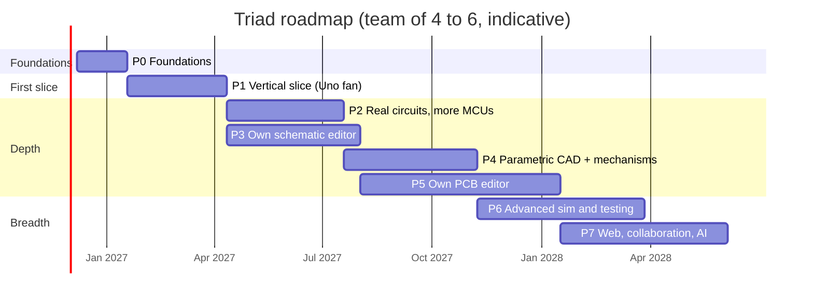

# Triad: roadmap

How we get from an empty repo to the app described in [PLAN.md](PLAN.md). Every
phase ends in a **demo that works end to end**: vertical slices, not horizontal
layers. Durations assume **a team of 4–6 engineers**. A solo builder working
with AI should follow the [solo track](#solo-track) instead.

| Milestone | When (team of 4–6) | What users can do |
|---|---|---|
| **M1 "It runs"** | end of P1 (week 18, ~4 months) | Write Arduino code, wire it in KiCad, see the board in a generated enclosure, press Run, watch the motor spin in 3D, pass a test |
| **M2 "Real engineering"** | end of P2–P3 (week 34, ~8 months) | Accurate SPICE co-sim, Pico and STM32 targets, schematic editing inside Triad |
| **M3 "v1.0"** | end of P4–P5 (week 58, ~13.5 months) | Parametric enclosures and mechanisms with physics, PCB layout inside Triad, full release bundle |
| **M4 "Platform"** | end of P6–P7 (week 78, ~18 months) | FMU models, thermal/FEA sidecars, web edition, classroom features, AI assistant |

---

## Phase 0 · Foundations (≈6 weeks)

**Goal:** a branded Code-OSS build that opens a Triad project and knows about
all of its domains.

Deliverables
1. **Monorepo**: pnpm workspaces + Turborepo (TS), a Cargo workspace (Rust), and
   CI on Linux, Windows and macOS.
2. **Desktop distribution pipeline**: pin an upstream Code-OSS tag, apply a
   `patches/` series (VSCodium approach), build `product.json` with **Open VSX**
   configured, and harden the fuses (RunAsNode off, Inspect off). Nightly builds.
3. **Project format v0**: `triad.toml` schema, `.triad/links.json`,
   generated TS types, and a project explorer view with Code / Electronics /
   Mechanical / Simulation nodes.
4. **`triad-kicad` crate**: lossless S-expression parser and serializer for
   `.kicad_sch`, `.kicad_pcb`, `.kicad_sym` and `.kicad_mod`. Round-trip
   tests on **every project in `kicad-demos`**.
5. **Companion manager**: detect and version-check KiCad (kicad-cli), Blender,
   Renode, PlatformIO and arduino-cli, with guided install.
6. **Netlist and link graph v0**: `kicad-cli sch export netlist` → nets, pins
   and components, linked by UUID.
7. **Benchmarks harness** for the PLAN §4.14 budgets (even if most are still empty).

Exit demo: open `kicad-demos/…` and a sample firmware folder as a Triad
project. The explorer lists components, nets and firmware files. CI is green
on three OSes.

---

## Phase 1 · Vertical slice: "Smart Fan Lite" on Arduino Uno (≈12 weeks)

**Goal:** the first end-to-end Run across all four domains, at T0 fidelity.

Deliverables
- **Code:** PlatformIO/arduino-cli build tasks, clangd, a Uno board profile,
  **generated `board_pins.h`**, and "pin not connected" diagnostics.
- **Electronics:** WebGL **schematic and PCB viewers** (read-only, layers,
  net highlight), **Edit in KiCad** with live reload, and **IPC cross-probe**
  (select in Triad ↔ select in KiCad) via kicad-python/kipy.
- **Mechanical:** 3D board via `kicad-cli pcb export glb` → three.js. An
  **enclosure template** on OCCT-WASM: box, shell, lid, bosses at mounting
  holes, **automatic connector cutouts**. STL/3MF/STEP export. Clearance check
  between component bounding volumes and the enclosure.
- **Simulation T0:** sim service with the kernel (virtual clock, quanta,
  early return), **avr8js** unit, logic nets, a small MNA solver for
  divider/pot/LED islands, **MuJoCo** unit (fan rotor as a hinge with drag),
  smart parts (LED, button, pot, NTC, MOSFET + DC motor, servo), a serial
  monitor, and LED glow and spinning rotor in 3D. Real-time pacing.
- **Tests:** scenario YAML v0 (`at`, `within`, `always`), `triad test` CLI and
  Test Explorer integration.

Exit demo (recorded): the walkthrough in PLAN §3, steps 1–6 and 9, on Uno with
the T0 tier. CI runs `overheat.yaml` headless and passes.

---

## Phase 2 · Real circuits and more microcontrollers (≈14 weeks)

- **ngspice unit** (T1): `Init_Sync` external sources driven by MCU pins,
  `SetBkpt` lockstep, event nodes. Per-island tier switch in the UI.
- **T2 analyses**: OP, DC sweep, AC, transient and parameter sweep, with a
  waveform viewer (KiCad-simulator parity for the common cases).
- **RP2040 (rp2040js)** including PIO, USB-CDC serial and **MicroPython** support.
- **Renode unit** (STM32 Nucleo, nRF52840-DK): `.repl` **generated from the
  netlist**, GPIO and UART bridging, quantum sync.
- **Debug-in-sim**: DAP → GDB → emulator stubs (rp2040js, simavr-compatible,
  Renode). Breakpoints freeze the whole world.
- **Instruments**: oscilloscope, logic analyzer with I²C/SPI/UART decode,
  current and energy budget.
- **Part SDK v1** (WASM) and ~60 smart parts: OLED SSD1306 (framebuffer shown on
  the 3D part), MPU-6050 (IMU from MuJoCo), HC-SR04 (`mj_ray`), DHT22, WS2812,
  L298N/DRV8833, relay, buzzer (Web Audio).
- **MCP server v0** (`run_scenario`, `get_pin_map`, `get_waveform`) so AI
  agents can drive the app.
- *Stretch:* ESP32 via QEMU (Espressif fork), if D3 says ESP32 is a priority.

Exit demo: the flyback-diode lesson (PLAN §3 step 7) in T1. A Pico robot
reads its IMU and drives two motors. Breakpoint debugging in sim.

---

## Phase 3 · Own schematic editor (≈16 weeks, parallel to P2)

- Editing: place symbols (KiCad libraries + smart parts browser), wires,
  junctions, labels (local, global, hierarchical), buses, power symbols,
  hierarchical sheets, annotation, properties, groups.
- **Writes native `.kicad_sch`.** Golden round-trip tests: KiCad must open our
  output without diffs beyond formatting.
- Live ERC (our rules) plus `kicad-cli sch erc` for sign-off. Undo across
  domains: renaming a net updates the firmware header in the same transaction.
- Code ↔ schematic: hover, jump and rename-refactor of pin symbols in both directions.
- KiCad **remote parts provider** endpoint serving smart parts into KiCad.

Exit demo: build the Phase 1 project's schematic from scratch inside Triad.
KiCad opens it cleanly. The firmware header and simulation update live.

---

## Phase 4 · Parametric CAD and mechanisms (≈16 weeks)

- **Sketcher** with constraint solver (PlaneGCS or SolveSpace per D1),
  dimensions and project parameters.
- **Features**: extrude, revolve, sweep, loft, fillet, chamfer, shell,
  hole wizard, linear/circular pattern, mirror, boolean. Feature tree with
  rollback and editing (Blender-style non-destructive stack UX).
- **Assemblies**: rigid groups, joints (revolute, prismatic, ball, fixed), motors
  bound to smart parts. **mjSpec generation** for MuJoCo, plus materials and mass
  properties.
- Board ↔ enclosure constraints: outline, holes and connectors drive features.
  **Interference and clearance** from real component 3D models (OCCT).
- **Blender companion**: "Render product shot" (Cycles in background mode) and
  "Edit mesh in Blender" round-trip through glTF with ID-preserving extras.

Exit demo: design a 2-DOF robot arm enclosure and linkage. It simulates with
servos driven by Pico firmware, gets a Cycles render, and exports STEP + 3MF.

---

## Phase 5 · Own PCB editor (≈24 weeks)

- Placement (move, rotate, flip, align), ratsnest, **interactive routing**
  (walkaround first, then a shove subset), vias, length display, tracks and arcs.
- Copper zones and fills (Clipper2-based filler, or the headless KiCad engine
  per D1), stackup editor, net classes, design rules.
- Live DRC (our rules) with **kicad-cli DRC as the sign-off**. Fab outputs
  via kicad-cli jobsets.
- **Board outline from the enclosure** and keep-outs from mechanical
  clearances. Incremental 3D updates without kicad-cli export.
- *Decision point:* revisit D1. A GPL-3 relicense would let us reuse KiCad's
  push-and-shove router.

Exit demo: lay out the Smart Fan board in Triad. KiCad's DRC passes. Order-ready
Gerbers come out, and the 3D fit check passes.

---

## Phase 6 · Advanced simulation and testing (≈20 weeks)

- **FMI 3.0 FMU import** (Modelica/OpenModelica, Simulink-exported models) and SSP.
- Thermal: a lumped RC network from component power dissipation (fast). Elmer
  sidecar for PCB and enclosure thermal (accurate).
- Structural: a CalculiX sidecar for enclosure stress (drop and clip snap-fits).
- Monte Carlo and tolerance analysis, parameter sweeps (MuJoCo `mjb_*` batch
  rollouts for mechanisms).
- Test coverage reports (firmware lines and scenario expectations).
  **Instructor mode**: hidden scenarios, auto-grading, LMS export.
- Optional **hardware bridge**: a real board's serial/GPIO mirrored into the sim
  (HIL-lite).

## Phase 7 · Web edition, collaboration and AI (≈20 weeks)

- **Web edition** from the same code: Code-OSS web + WASM engines (OCCT,
  ngspice, JS MCU emulators, MuJoCo if a WASM build proves out). For classrooms
  and Chromebooks.
- Visual diffs for schematic, PCB and CAD in git. Comments and reviews. Optional
  real-time collaboration (CRDT on the model service).
- **AI design assistant** on the MCP server: "why doesn't my motor spin?" answered
  from live sim evidence, design reviews, and part suggestions.

---

## Solo track

If the builder is one person plus AI assistance, **cut ruthlessly** and ship the
magic first:

1. **S0 (4–6 weeks):** monorepo, Code-OSS build (or a stock-VS Code extension pack
   only, with no fork yet), the KiCad parser with round-trip tests, the project explorer.
2. **S1 (8–12 weeks):** Phase 1 slice with **KiCad as the only editor**,
   kicad-cli GLB for 3D, the template enclosure, avr8js + MuJoCo + 10 parts,
   scenario tests.
3. **S2 (8–12 weeks):** rp2040js, ngspice T1 for one analog island type, OLED
   and IMU parts, debug-in-sim.

That gives a compelling, demoable product in about 6–8 months. Then decide
whether to grow a team (Phases 3–5), seek grants (education and open-hardware
funds), or keep KiCad and Blender as the long-term editors.

---

## Phase 0, sprint 1: concrete first tasks

1. Scaffold the monorepo (`apps/`, `extensions/`, `packages/`, `crates/`,
   `services/`) with CI for lint, typecheck and test.
2. `crates/triad-kicad`: S-expression tokenizer and tree, lossless writer,
   round-trip test runner over `kicad-demos`.
3. `apps/desktop`: script that fetches Code-OSS at a pinned tag, applies
   `patches/`, writes `product.json` (name, Open VSX) and builds for linux-x64.
4. `extensions/triad-project`: reads `triad.toml` and shows the domain tree.
5. `extensions/triad-electronics`: calls `kicad-cli sch export netlist` and
   shows nets and components. Read-only schematic viewer spike (WebGL2).
6. `services/sim-service` spike: avr8js runs a Blink `.hex`. The LED state
   streams over a MessagePort to a three.js view where an LED glows.

Definition of done for every phase: exit demo recorded, CI green on three
OSes, performance budgets measured, docs updated, ADRs written for new
decisions, and a license scan clean.
